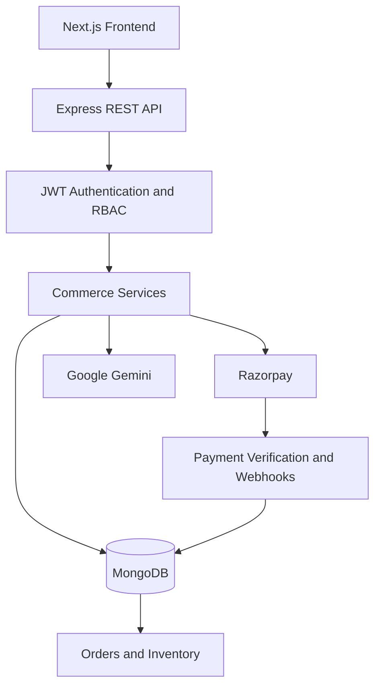

# KiranaWala — Hyperlocal Grocery Platform

A full-stack grocery commerce platform for neighborhood shoppers, local store owners, and delivery partners. KiranaWala combines store discovery, cart and coupon workflows, backend-authoritative checkout, Razorpay payments, order tracking, and Gemini-powered Smart Search.

**Live application:** https://kirana-wala-1nhp.vercel.app  
**Repository:** https://github.com/Jyatin/KiranaWala  
**API documentation:** [docs/API_REFERENCE.md](docs/API_REFERENCE.md)  
**QA and security report:** [QA_REPORT.md](QA_REPORT.md)

[](https://github.com/Jyatin/KiranaWala/actions/workflows/node.js.yml)
[](https://github.com/Jyatin/KiranaWala/actions/workflows/lint.yml)

## Key engineering features

- **Inventory consistency:** Conditional atomic MongoDB updates reserve stock only when sufficient inventory is available; failed reservations can be rolled back.
- **Payment verification:** Razorpay payment verification uses HMAC-SHA256 signatures, raw webhook request bodies, and timing-safe comparisons.
- **Order and delivery workflows:** Explicit order-state transitions, payment reconciliation, role-based access control, and customer OTP verification for delivery completion.
- **Smart Search:** Gemini-powered shopping search integration with fallback behavior when the AI key is unavailable.
- **Engineering workflow:** Jest and Supertest backend tests, ESLint, GitHub Actions CI, and Docker/Docker Compose support.

> **Payment note:** Signature verification and webhook processing are implemented. Verify duplicate-event handling and concurrent processing before describing the entire payment lifecycle as exactly-once or fully idempotent.

## Screenshots

<!-- TODO: Replace or confirm these images are current screenshots from the deployed application. -->
| Store discovery | Cart and checkout |
|---|---|
|  |  |

| Merchant dashboard | Order tracking |
|---|---|
|  |  |

## Features

### Shopping and checkout
- Browse stores and products by neighborhood, area, and category.
- Add products to a cart; enforce the single-store checkout rule.
- Calculate prices, delivery fees, and eligible discounts on the backend rather than trusting client totals.
- Validate percentage, fixed-value, and free-delivery coupons.
- Reserve inventory during checkout and track order status through fulfillment.
- Use Razorpay payment flows with server-side signature verification and webhook processing.

### Store and delivery operations
- Store owners can manage store availability, inventory, and incoming orders.
- Delivery partners can view eligible orders, claim deliveries, and advance fulfillment status.
- Customers can track their orders and access their own delivery OTP.
- OTP verification includes attempt limits and temporary lockout.

### Smart Search and AI
- Integrates the Google Gemini SDK for AI-assisted grocery search.
- The backend environment template documents graceful handling when `GEMINI_API_KEY` is missing; the AI endpoint can return HTTP 503 while other commerce functionality remains available.

<!-- TODO: Document the actual Smart Search retrieval pipeline, data source, grounding, and fallback behavior. Retrieval is currently described as in-memory; do not imply persistent vector search unless implemented. -->

## Tech stack

| Area | Technologies |
|---|---|
| Frontend | Next.js 16, React 19, TypeScript |
| Styling | Tailwind CSS 4, Lucide React |
| Backend API | Node.js 20, Express 5 |
| Database | MongoDB, Mongoose 8 |
| Authentication | JWT, bcryptjs, role-based access control |
| Payments | Razorpay SDK, Node.js Crypto, HMAC-SHA256 verification |
| AI | Google Gemini SDK |
| Tests | Jest, Supertest, MongoDB Memory Server |
| Linting | ESLint |
| CI | GitHub Actions |
| Local containers | Docker, Docker Compose |
| Hosting described by the project | Vercel frontend, Render backend, MongoDB Atlas |

## Architecture overview

The Next.js frontend communicates with a modular Express API. The API applies authentication and authorization, executes commerce rules, persists data in MongoDB, and integrates with Razorpay and Gemini.



### Important backend decisions

- **Server-authoritative pricing:** The client submits product IDs and quantities; the backend reads current product prices and validates discounts.
- **Atomic stock reservation:** MongoDB conditional updates maintain available, reserved, and sold stock counters.
- **Payment recovery:** A reconciliation service checks pending payments with Razorpay and updates applicable order states.
- **Raw-body webhook validation:** The webhook route preserves the request body used for HMAC verification.
- **Search input safety:** Store and product search terms use centralized regex sanitization.
- **Order lifecycle:** Orders move through explicit states, including payment, packing, pickup, delivery, cancellation, and refund states where applicable.

## Repository structure

```text
KiranaWala/
├── .github/workflows/       # GitHub Actions CI and lint workflows
├── docs/
│   ├── API_REFERENCE.md     # API routes, payloads, and responses
│   ├── AUDIT_BASELINE.md
│   ├── PAYMENT_INVENTORY_CODE_REVIEW.md
│   └── screenshots/         # Application screenshots
├── server/
│   ├── config/              # Environment and JWT configuration
│   ├── middleware/          # Authentication, authorization, rate limiting
│   ├── models/              # Mongoose models
│   ├── routes/              # REST API routes
│   ├── scripts/             # Safe demo-data seeding
│   ├── services/            # Inventory, payment, reconciliation, coupons
│   ├── utils/               # Order state machine and sanitization
│   ├── __tests__/           # Backend test suite
│   ├── Dockerfile
│   └── server.js
├── src/                     # Next.js application
├── docker-compose.yml
├── .env.example             # Frontend environment template
├── package.json
├── QA_REPORT.md
└── README.md
```

## Getting started

### Prerequisites

- Node.js **20.x LTS**
- npm compatible with the lockfiles
- MongoDB locally, or a MongoDB connection URI
- Docker Desktop (optional, for containerized development)

### 1. Clone the repository

```bash
git clone https://github.com/Jyatin/KiranaWala.git
cd KiranaWala
```

### 2. Install dependencies

```bash
npm install
npm install --prefix server
```

### 3. Configure environment variables

Copy the checked-in templates:

```bash
cp .env.example .env.local
cp server/.env.example server/.env
```

The root `.env.example` contains the frontend variables:

```dotenv
NEXT_PUBLIC_API_URL=http://localhost:3000
NEXT_PUBLIC_RAZORPAY_KEY_ID=rzp_test_placeholder_key_id
NEXT_PUBLIC_APP_URL=http://localhost:3001
```

Configure `server/.env` with your local values. The server template includes the following settings:

```dotenv
NODE_ENV=development
PORT=3000
FRONTEND_URL=http://localhost:3001
MONGO_URI=mongodb://127.0.0.1:27017/kiranawala
JWT_SECRET=replace_with_a_random_secret_at_least_32_characters
JWT_EXPIRES_IN=24h
RAZORPAY_KEY_ID=rzp_test_placeholder_key_id
RAZORPAY_KEY_SECRET=replace_with_your_test_secret
RAZORPAY_WEBHOOK_SECRET=replace_with_your_webhook_secret
GEMINI_API_KEY=
ALLOW_DEMO_SEEDING=false
DEMO_USER_PASSWORD=replace_with_a_local_demo_password
```

Use test credentials for local payment development. Replace placeholder values with your own secrets; never commit real credentials. A production JWT secret must be sufficiently strong and at least 32 characters, according to the server configuration.

### 4. Run the application

Start MongoDB first, then start the backend in one terminal:

```bash
npm run server
```

Start the frontend in a second terminal:

```bash
npm run dev -- -p 3001
```

Open http://localhost:3001.

<!-- TODO: Verify a clean-checkout startup end to end, including CORS, API URL, and frontend/backend port configuration. -->

## Docker Compose

To start the services defined in the repository's Compose file:

```bash
docker compose up -d --build
docker compose ps
docker compose logs -f backend
```

Stop the services with:

```bash
docker compose down
```

<!-- TODO: Confirm the Compose service names, environment requirements, and persistent-volume behavior on a clean machine. -->

## Tests, linting, and build

Run backend tests from the repository root:

```bash
npm test -- --runInBand
```

Run ESLint for the backend:

```bash
npm run lint --prefix server
```

Check frontend TypeScript and build the Next.js application:

```bash
npm run type-check
npm run build
```

The test suite and QA report cover areas including authentication, checkout, inventory concurrency, orders, coupons, payments, and security regression cases. GitHub Actions workflows are located in `.github/workflows/`.

**Test-count note:** The README and QA report have reported different suite/test totals. Re-run the suite on the current commit before publishing a fixed count or a “100% passing” badge.

## API overview

See [docs/API_REFERENCE.md](docs/API_REFERENCE.md) for full request and response details.

| Method | Endpoint | Purpose |
|---|---|---|
| `POST` | `/api/customer/register` | Register a customer |
| `POST` | `/api/customer/login` | Authenticate a customer |
| `GET` | `/api/customer/stores` | Discover stores |
| `GET` | `/api/customer/products` | Browse products |
| `POST` | `/api/customer/checkout` | Create an order and reserve stock |
| `POST` | `/api/coupons/validate` | Validate a coupon |
| `POST` | `/api/payments/verify` | Verify a client payment flow |
| `POST` | `/api/payments/webhook` | Process Razorpay webhook events |
| `GET` | `/api/delivery/available` | List available delivery orders |
| `PATCH` | `/api/delivery/orders/:id/claim` | Claim a delivery |
| `PATCH` | `/api/delivery/orders/:id/status` | Update fulfillment status |
| `GET` | `/api/delivery/orders/:id/track` | Retrieve order tracking information |
| `POST` | `/api/search/smart` | Smart Search endpoint; confirm current route and request schema in source/API docs |

## Known limitations

- **In-memory retrieval:** Smart Search retrieval is currently described as in-memory. This limits persistence and scaling compared with a durable search index or vector database. Confirm the exact implementation and document how the index is built and refreshed.
- **End-to-end payment coverage:** The repository documents payment and webhook tests, but a complete end-to-end test of checkout through payment confirmation and delivery still needs to be added or explicitly verified.
- **In-memory rate limiting:** Rate-limit state resets on restart and is not shared across horizontally scaled instances; Redis is a possible future improvement.
- **Single-store carts:** An order cannot combine products from multiple stores.
- **External AI dependency:** Smart Search depends on Gemini availability and configuration. Missing-key behavior is documented as HTTP 503.
- **Observability:** Structured logs and distributed tracing are documented as future improvements, not existing capabilities.

## Contributing

Keep contributions focused and include tests for changes to checkout, inventory, payment processing, authorization, or order transitions. Before opening a pull request, run the relevant tests and lint/build checks. Do not include secrets, production data, or credentials in commits.

## Author

**Jyatin Singh**

- GitHub: [@Jyatin](https://github.com/Jyatin)
- LinkedIn: https://www.linkedin.com/in/jyatinsingh/