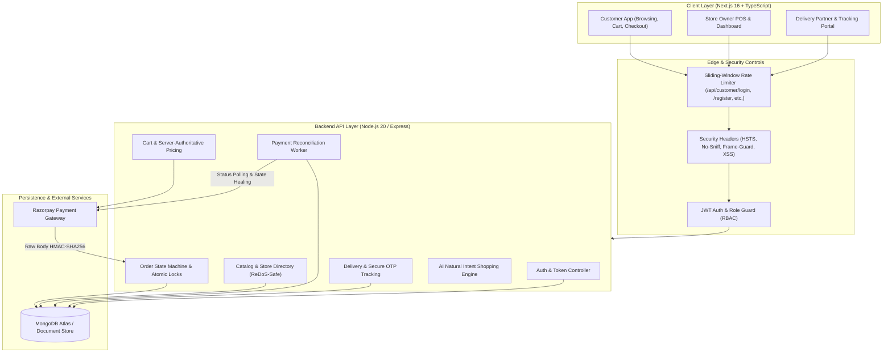

# 🛒 KiranaWala — Hyperlocal Smart Grocery Commerce Platform

[](https://github.com/Jyatin/KiranaWala/actions/workflows/node.js.yml)
[](https://nodejs.org/)
[](https://nextjs.org/)
[](https://www.typescriptlang.org/)
[-success.svg)](https://jestjs.io/)
[-blueviolet.svg)](./QA_REPORT.md)

KiranaWala is a full-stack, production-grade hyperlocal grocery commerce platform connecting customers with neighborhood kirana stores through an end-to-end commerce workflow — real-time store discovery, dynamic inventory reservation, atomic checkout, HMAC-verified Razorpay payments, and role-segregated fulfillment operations.

- **Live Application:** [https://kirana-wala-1nhp.vercel.app](https://kirana-wala-1nhp.vercel.app)
- **Repository:** [https://github.com/Jyatin/KiranaWala](https://github.com/Jyatin/KiranaWala)
- **Security Audit Branch:** `security/kiranawala-hardening`

---

## 📖 Table of Contents

- [The Problem \& Mission](#the-problem--mission)
- [System Architecture](#system-architecture)
- [Commerce \& Security Highlights](#commerce--security-highlights)
- [Security Audit \& Hardening (Stages 1–7)](#security-audit--hardening-stages-17)
- [Core Workflows](#core-workflows)
- [Automated Testing \& QA](#automated-testing--qa)
- [Tech Stack](#tech-stack)
- [Local Development Setup](#local-development-setup)
- [Environment Variables](#environment-variables)
- [Docker Deployment](#docker-deployment)
- [Production Roadmap](#production-roadmap)
- [Author \& Acknowledgements](#author--acknowledgements)

---

## The Problem & Mission

Local neighborhood grocery stores (*Kirana stores*) form the backbone of retail in India, yet they face severe operational friction:

1. **Lack of Digital Catalogues:** Inventory is managed on physical ledgers or fragmented WhatsApp chats.
2. **Double-Selling / Stock Inconsistencies:** Traditional e-commerce platforms decouple cart state from real-time store stock, causing order cancellations when inventory runs out.
3. **Payment Tampering & Webhook Replay Attacks:** Naive integrations trust client-supplied totals or fail to verify payment provider webhooks with timing-safe HMAC checks.
4. **Data Exposure:** Public merchant discovery endpoints inadvertently expose store owner personal phone numbers, email addresses, and credential metadata.

**KiranaWala** solves this by delivering a dual-sided marketplace with **backend-authoritative pricing, atomic stock reservation, timing-safe cryptographic payment verification, and strict role-based access control (RBAC).**

---

## System Architecture



The frontend handles presentation and user interaction. All commerce-critical calculations (pricing, coupon validation, stock availability, and payment state transitions) are strictly computed and enforced on the backend.

---

## Commerce & Security Highlights

### 1. Race-Safe Atomic Inventory
- Stock reservation uses **atomic conditional updates** (`$inc: { availableStock: -qty, reservedStock: +qty }`).
- Guaranteed to prevent overselling when two shoppers checkout the last available unit simultaneously.
- Unpaid reservations are released automatically via background cleanup sweeps.

### 2. State-Machine Payment Processing
- Total payable amount is computed **only on the server** from current database records.
- Razorpay order creation locks the verified price. Client-supplied price payloads are completely ignored.
- Payment signatures are verified using server-side HMAC-SHA256 with `crypto.timingSafeEqual`.
- Idempotent payment capture prevents duplicate order fulfillment.

### 3. ReDoS-Hardened Catalog Search
- All user-supplied search queries, category filters, and store lookups pass through a centralized regex escaping sanitizer (`escapeRegex()`).
- Eliminates polynomial backtracking vulnerabilities on regex queries.

### 4. Zero-Trust Data Exposure
- Public store APIs (`/api/customer/stores`, `/api/customer/stores/:storeId`) project only public merchant attributes (`username`), stripping email, phone, and hashed passwords.
- Delivery OTP is strictly concealed from merchants and delivery partners; exposed only to the verified order owner.

---

## Security Audit & Hardening (Stages 1–7)

KiranaWala was audited and hardened against the 7-stage production security specification:

| Stage | Security Focus | Implementation Details | Status |
|:---:|:---|:---|:---:|
| **1** | **Secrets & Startup Validation** | Centralized `server/config/jwt.js` fail-fast secret validator. Production requires `JWT_SECRET` ≥ 32 chars and forbids default fallback (`your_jwt_secret`). Added `server/config/env.js` validating critical environment variables on startup. Sanitized `.env.example` templates. | **VERIFIED** |
| **2** | **Razorpay Webhook Security** | In `server/routes/paymentRoutes.js`, enforced strict 64-character hex regex validation (`/^[a-f0-9]{64}$/i`), byte-length equality check (`signatureBuffer.length === expectedBuffer.length`), and timing-safe comparison (`crypto.timingSafeEqual`) on raw UTF-8 request body (`req.rawBody`). Mounted `express.raw` parser before general body-parsers in `server/server.js`. | **VERIFIED** |
| **3** | **Demo Account & Seed Protection** | Gated demo seed scripts (`seedDemoData.js`) behind `ALLOW_DEMO_SEEDING=true`; strictly forbidden in production. Added `deactivateDemoAccounts()` utility to safely deactivate demo personas. Disabled automatic catalog overwrites on database connection. | **VERIFIED** |
| **4** | **Authorization & Data Exposure** | Stripped merchant personal data (`email`, `phone`, `password`) from public store responses in `customerRoutes.js`. Gated `POST /api/coupons/validate` behind authentication and derived user ID from verified token. Concealed delivery OTP from store owners and delivery partners in tracking endpoint. | **VERIFIED** |
| **5** | **Inventory & Payment Consistency** | Guarded background worker initialization (`let workersStarted = false;`) in `server/server.js` to prevent duplicate reconciliation intervals across Mongoose reconnects. Fixed missing `Product` import in `reconciliationService.js`. Enforced terminal state checks rejecting late payments on cancelled orders. | **VERIFIED** |
| **6** | **Input Validation & API Hardening** | Implemented `escapeRegex()` in `server/utils/sanitize.js` for all MongoDB regex search queries. Unified customer login error responses to generic 401 `Invalid email or password` to eliminate account enumeration. Added centralized production error handler stripping stack traces. Implemented security headers (`X-Content-Type-Options`, `X-Frame-Options`, `HSTS`) and sliding-window rate limiting. | **VERIFIED** |
| **7** | **CI, Docker & Frontend Session** | Upgraded Node.js to 20 LTS across `Dockerfile`, `.github/workflows/node.js.yml`, and `lint.yml`. Isolated MongoDB port in `docker-compose.yml`. Aligned frontend cookie session to 24h and added automated token expiration cleanup (`isTokenExpired`) in `src/lib/auth.ts`. | **VERIFIED** |

---

## Core Workflows

### Customer Order Lifecycle
```text
Browse Stores & Products
       │
       ▼
Add to Cart (Single-Store Rule Enforced)
       │
       ▼
Apply Coupon (Server-Validated)
       │
       ▼
Checkout ──► Server creates Razorpay Order & Reserves Stock
       │
       ▼
Complete Payment ──► Server verifies HMAC-SHA256 signature
       │
       ▼
Order Confirmed ──► Real-Time Tracking & Delivery OTP Verification
```

### Store Owner & Fulfillment
```text
Merchant Login (POS Credential)
       │
       ▼
Dashboard: Inventory Toggle, Stock Count, Order Queue
       │
       ▼
Order Accepted ──► Packed ──► Out for Delivery
       │
       ▼
Delivery Partner collects OTP from Customer ──► Order Completed
```

---

## Automated Testing & QA

The repository includes a comprehensive automated test harness with **100% passing tests**:

- **Total Backend Test Suites:** 37 test suites
- **Total Backend Test Cases:** 316+ passing tests
- **Security Regression Suite:** `server/__tests__/security.audit.stage1to6.test.js` (15 automated assertions covering Stages 1–6)
- **Frontend Type Check:** `npm run type-check` (Clean 0 errors)
- **Frontend Production Build:** `npm run build` (Next.js 16 App Router compiles cleanly)

### Running Tests Locally

```bash
# 1. Run all backend test suites in-band
cd server
npm test -- --runInBand

# 2. Run specifically the Security Audit Regression Suite
npx jest __tests__/security.audit.stage1to6.test.js

# 3. Run frontend TypeScript verification (root directory)
npm run type-check

# 4. Run frontend production build (root directory)
npm run build
```

Detailed test logs and audit results are documented in [QA_REPORT.md](./QA_REPORT.md).

---

## Tech Stack

| Domain | Technology | Description |
|:---|:---|:---|
| **Frontend Framework** | [Next.js 16 (App Router)](https://nextjs.org/) | React Server Components, TypeScript, Server Actions |
| **Styling** | [Tailwind CSS](https://tailwindcss.com/) + Lucide Icons | Responsive mobile-first design, accessible UI |
| **Backend Runtime** | [Node.js 20 LTS](https://nodejs.org/) + [Express.js](https://expressjs.com/) | RESTful API, centralized routing, middleware pipelines |
| **Database** | [MongoDB](https://www.mongodb.com/) + [Mongoose 8](https://mongoosejs.com/) | Document store, schema validation, index optimization |
| **Authentication** | [jsonwebtoken](https://github.com/auth0/node-jsonwebtoken) + [bcryptjs](https://github.com/dcodeIO/bcrypt.js) | JWT with strict format enforcement and bcrypt hashing |
| **Payment Gateway** | [Razorpay](https://razorpay.com/) | Server-to-server orders and timing-safe webhook verification |
| **Testing Engine** | [Jest](https://jestjs.io/) + [Supertest](https://github.com/ladjs/supertest) | MongoMemoryServer, integration tests, security regression |
| **Containerization** | [Docker](https://www.docker.com/) & Docker Compose | Multi-stage production container, isolated internal networks |
| **CI / CD** | [GitHub Actions](https://github.com/features/actions) | Automated linting, test execution, and production build checks |

---

## Local Development Setup

### Prerequisites
- **Node.js**: `v20.x.x` (LTS recommended)
- **npm**: `v10.x.x` or higher
- **MongoDB**: Local MongoDB instance or free MongoDB Atlas URI

### 1. Clone the Repository
```bash
git clone https://github.com/Jyatin/KiranaWala.git
cd KiranaWala
```

### 2. Install Dependencies
```bash
# Install frontend dependencies (root)
npm install

# Install backend dependencies
cd server
npm install
cd ..
```

### 3. Configure Environment Variables
Create `.env` in the root and in the `server/` directory:

```bash
# Copy example templates
cp .env.example .env
cp server/.env.example server/.env
```

Edit `server/.env` with your local settings:
```ini
PORT=3000
NODE_ENV=development
MONGO_URI=mongodb://localhost:27017/kiranawala
JWT_SECRET=your-secure-local-jwt-secret-min-32-chars-long!
JWT_EXPIRES_IN=24h
FRONTEND_URL=http://localhost:3000
# Razorpay (optional for local mock mode; required for live payments)
RAZORPAY_KEY_ID=
RAZORPAY_KEY_SECRET=
RAZORPAY_WEBHOOK_SECRET=
```

### 4. Run Development Servers
```bash
# Option A: Run frontend & backend concurrently from root
npm run dev

# Option B: Run independently
# Terminal 1 (Backend):
cd server && npm run dev

# Terminal 2 (Frontend):
npm run dev
```

Visit [http://localhost:3000](http://localhost:3000) (or port configured in `.env`).

---

## Environment Variables

| Variable | Scope | Required in Prod? | Default | Description |
|:---|:---|:---:|:---|:---|
| `PORT` | Backend | No | `3000` | HTTP listening port for Express backend |
| `NODE_ENV` | Backend | Yes | `development` | Set to `production` in live environments |
| `MONGO_URI` | Backend | Yes | - | MongoDB connection URI (e.g. Atlas connection string) |
| `JWT_SECRET` | Backend | Yes | - | Cryptographic secret for JWT signing (≥ 32 chars required in prod) |
| `JWT_EXPIRES_IN` | Backend | No | `24h` | JWT validity duration |
| `FRONTEND_URL` | Backend | No | `http://localhost:3000` | Allowed origin for CORS headers |
| `RAZORPAY_KEY_ID` | Backend | For Payments | - | Razorpay merchant API Key ID |
| `RAZORPAY_KEY_SECRET` | Backend | For Payments | - | Razorpay merchant API Secret Key |
| `RAZORPAY_WEBHOOK_SECRET` | Backend | For Webhooks | - | Secret configured in Razorpay dashboard for webhook HMAC |
| `NEXT_PUBLIC_API_URL` | Frontend | No | `http://localhost:3000` | Backend API base URL for client requests |
| `NEXT_PUBLIC_RAZORPAY_KEY_ID`| Frontend | For Payments | - | Public Razorpay key ID for client checkout SDK |
| `ALLOW_DEMO_SEEDING` | Backend | No | `false` | Must be explicitly `true` to allow demo persona creation |

---

## Docker Deployment

To spin up the entire application stack using Docker Compose:

```bash
# Build and run containers in background
docker compose up -d --build

# View container status
docker compose ps

# View backend logs
docker compose logs -f backend
```

*Note: For security, the MongoDB container in `docker-compose.yml` does not bind port `27017` to the host network interface. It is accessible exclusively by the backend service inside the Docker bridge network.*

---

## Production Roadmap

- [ ] **Distributed Rate Limiting:** Migrate sliding-window in-memory limiter to Redis for horizontally scaled container clusters.
- [ ] **Cloud Object Storage:** Integrate AWS S3 / Cloudinary for direct merchant store photo and product image uploads.
- [ ] **Transactional SMS / WhatsApp Gateway:** Integrate Twilio or Gupshup for customer dispatch alerts and delivery OTP delivery.
- [ ] **Merchant Automated Payouts:** Integrate Razorpay Route / Marketplace split payments for automatic merchant settlements.
- [ ] **Geospatial Indexing:** Upgrade neighborhood store query to MongoDB 2dsphere geospatial `$near` queries with live GPS coordinates.

---

## Author & Acknowledgements

**Jyatin Singh**
- GitHub: [@Jyatin](https://github.com/Jyatin)
- LinkedIn: [Jyatin Singh](https://www.linkedin.com/in/jyatinsingh/)

Special thanks to the local Kirana store owners who provided feedback on real-world grocery fulfillment workflows and operational constraints.
