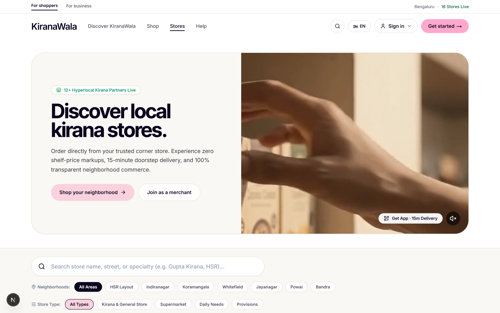
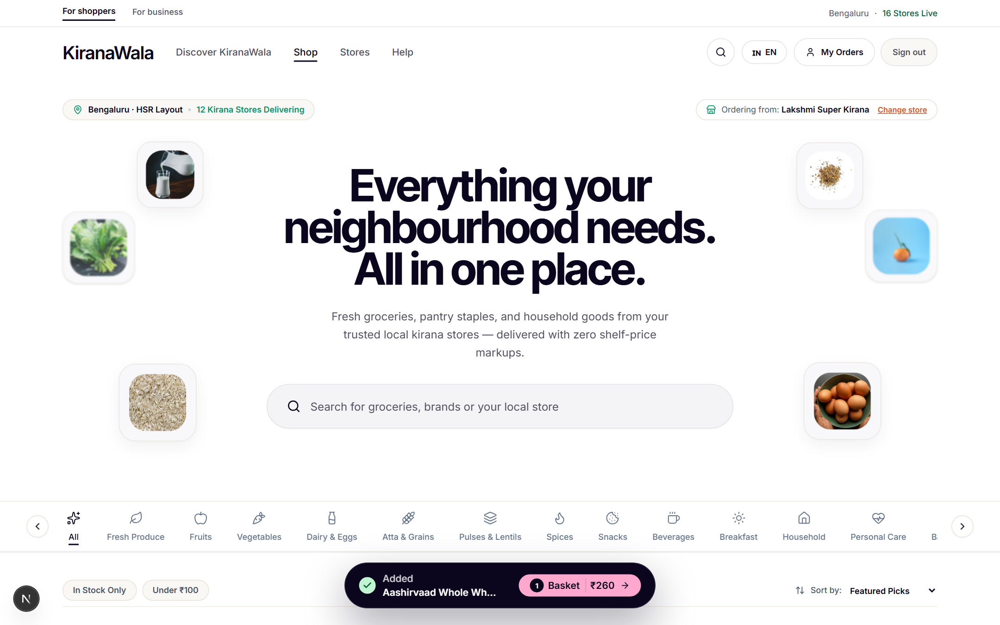
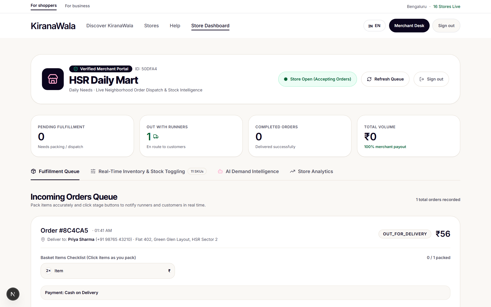
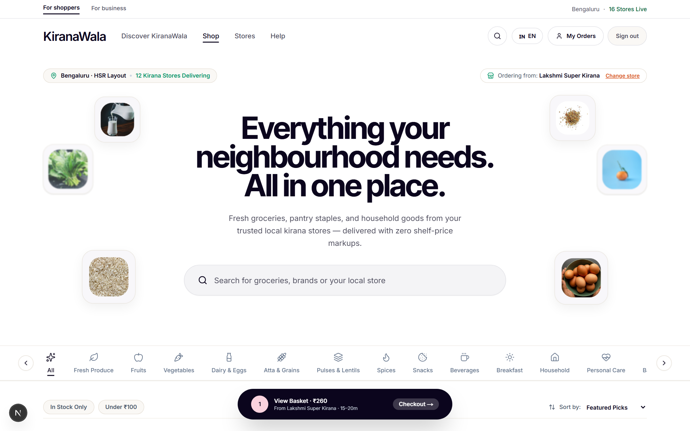
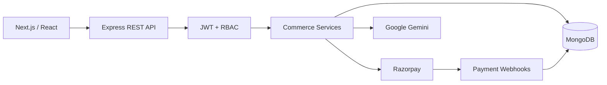

# 🛒 KiranaWala — Hyperlocal Smart Grocery Platform

> Bringing neighborhood kirana stores online with secure checkout, reliable inventory, and local delivery.

[](https://github.com/Jyatin/KiranaWala/actions/workflows/node.js.yml)
[](https://github.com/Jyatin/KiranaWala/actions/workflows/lint.yml)
[](https://github.com/Jyatin/KiranaWala/actions/workflows/node.js.yml)
[](QA_REPORT.md)

**Live app:** [kirana-wala-1nhp.vercel.app](https://kirana-wala-1nhp.vercel.app) · **QA report:** [QA_REPORT.md](QA_REPORT.md) · **API reference:** [docs/API_REFERENCE.md](docs/API_REFERENCE.md)

**Demo accounts** *(available only where demo seeding is enabled)* — password: `Password123!`
- Customer: `customer@kiranawala.demo`
- Store owner: `owner_gupta_hsr@kiranawala.demo`
- Delivery runner: `runner_rahul@kiranawala.demo`

> Demo seeding is disabled by default in production. These credentials may not work on the hosted app.

## Screenshots

<table>
<tr>
<td></td>
<td></td>
<td></td>
<td></td>
</tr>
</table>

*Store discovery, checkout, merchant inventory, and order tracking.*

## What is KiranaWala?

KiranaWala digitizes neighborhood Indian kirana stores, helping customers discover nearby shops, shop groceries, and place orders online. Store owners manage products and fulfillment, while local delivery runners handle last-mile delivery.

## What makes it different?

| Challenge | Implementation |
|---|---|
| Server-side pricing | Backend recalculates product prices, fees, and discounts instead of trusting client totals. |
| Atomic inventory | Conditional MongoDB updates use `$inc` with `$gte` to reserve stock safely under concurrent checkout. |
| Razorpay HMAC verification | Validates payment signatures using HMAC-SHA256 and timing-safe comparisons. |
| Reconciliation worker | Background worker that reconciles missed payment webhooks. |
| Delivery OTP | Customer OTP verification protects delivery completion, with attempt limits and lockout. |

## Architecture



## Tech stack

**Next.js 16 · React 19 · TypeScript · Tailwind CSS 4 · Node.js 20 · Express 5 · MongoDB · Mongoose · JWT · bcryptjs · Razorpay · Google Gemini · Jest · Supertest · ESLint · GitHub Actions · Docker**

## Quick start

```bash
git clone https://github.com/Jyatin/KiranaWala.git
cd KiranaWala
npm install
npm install --prefix server
cp .env.example .env
cp server/.env.example server/.env
```

Configure `server/.env` and ensure MongoDB is running. Start the API with `npm run server`, then start the frontend in another terminal with `npm run dev -- -p 3001`. Run backend tests using `npm test --prefix server -- --runInBand`.

## Limitations / roadmap

- Rate limiting is in-memory; Redis is needed to share limits across multiple backend instances.
- Structured logging and distributed tracing remain future improvements.
- Smart Search depends on Gemini configuration; without an API key, the AI endpoint returns HTTP 503 while core commerce features remain available. Retrieval is currently described as in-memory, not a persistent vector index.

## Docs and author

More detail: [QA/security report](QA_REPORT.md) · [REST API reference](docs/API_REFERENCE.md) · [Order and payment workflows](docs/WORKFLOWS.md) · [Audit baseline](docs/AUDIT_BASELINE.md) · [Payment/inventory review](docs/PAYMENT_INVENTORY_CODE_REVIEW.md)

**Jyatin Singh** · [GitHub](https://github.com/Jyatin) · [LinkedIn](https://www.linkedin.com/in/jyatinsingh/)
