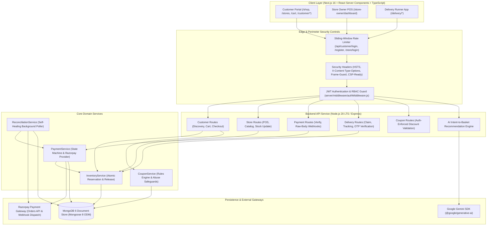
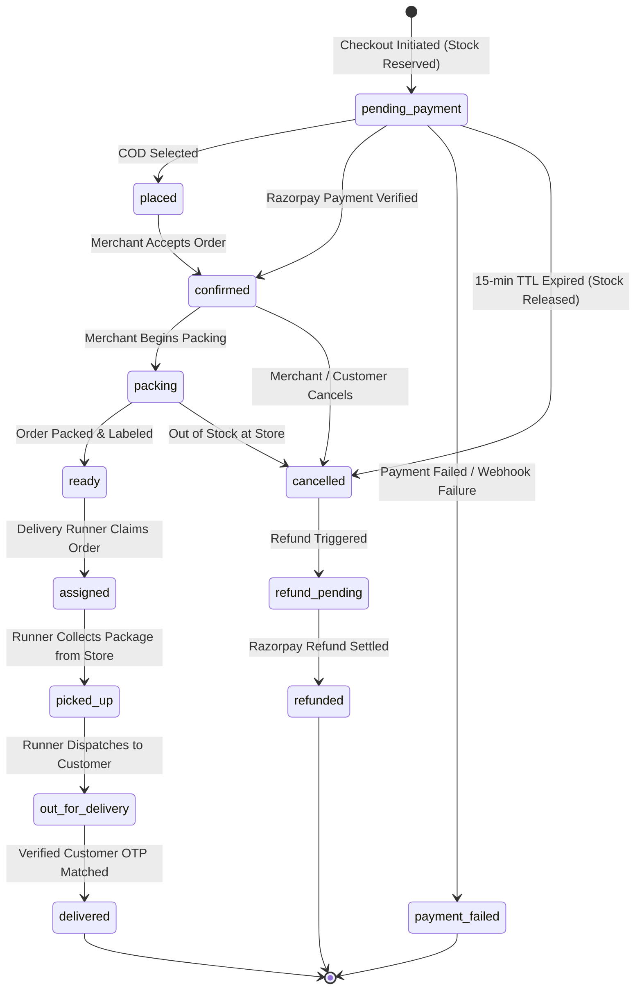
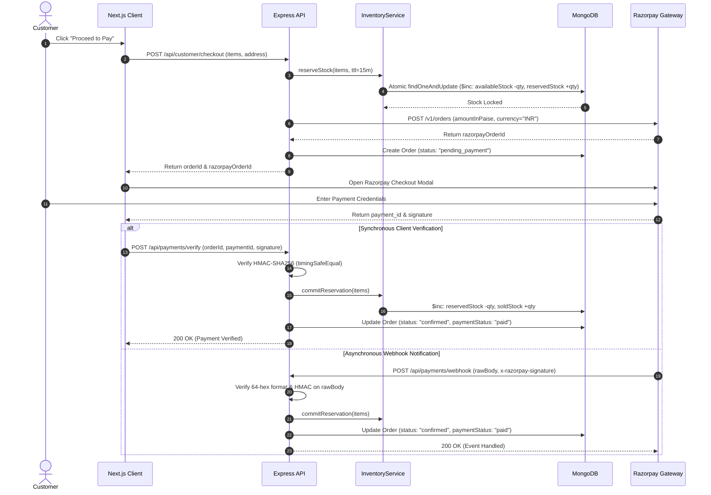
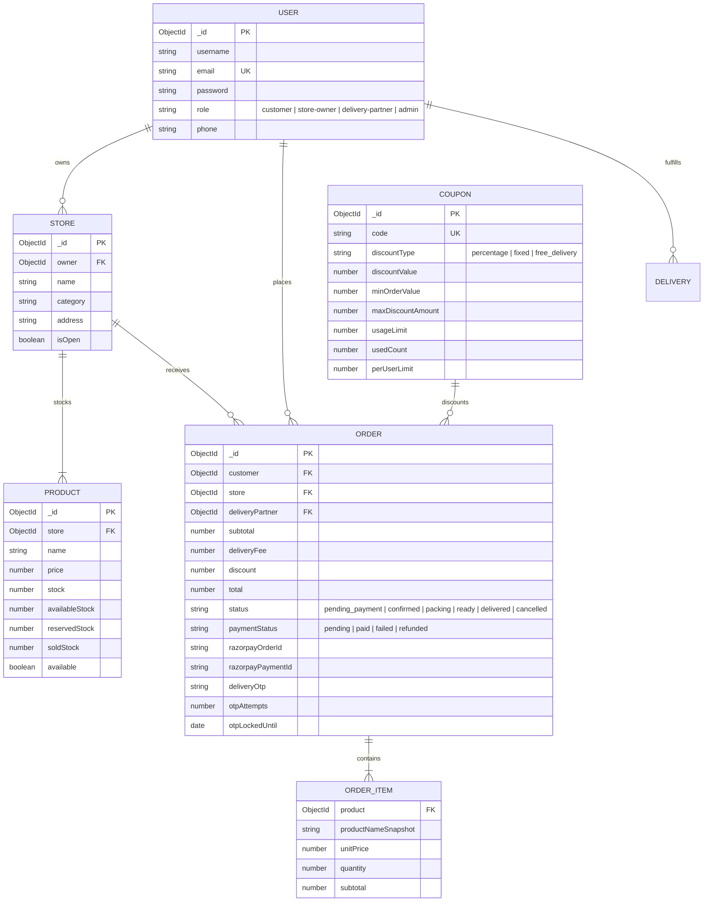

# 🛒 KiranaWala — Hyperlocal Smart Grocery Commerce Platform

[](https://github.com/Jyatin/KiranaWala/actions/workflows/node.js.yml)
[](https://github.com/Jyatin/KiranaWala/actions/workflows/lint.yml)
[](https://nodejs.org/)
[](https://nextjs.org/)
[](https://www.typescriptlang.org/)
[](https://www.mongodb.com/)
[-success.svg)](https://jestjs.io/)
[-blueviolet.svg)](./QA_REPORT.md)
[](./package.json)

> **A production-oriented hyperlocal grocery platform featuring backend-authoritative pricing, atomic inventory reservations, timing-safe Razorpay HMAC verification, and role-segregated fulfillment workflows.**

- **Live Application:** [https://kirana-wala-1nhp.vercel.app](https://kirana-wala-1nhp.vercel.app)
- **Repository:** [https://github.com/Jyatin/KiranaWala](https://github.com/Jyatin/KiranaWala)
- **Active Pull Request:** [PR #36: Security Hardening & Infrastructure Upgrade](https://github.com/Jyatin/KiranaWala/pull/36)
- **Comprehensive QA Report:** [QA_REPORT.md](./QA_REPORT.md)
- **Full REST API Reference:** [docs/API_REFERENCE.md](./docs/API_REFERENCE.md)

---

## 📑 Table of Contents

1. [Executive Overview](#1-executive-overview)
2. [System Architecture](#2-system-architecture)
3. [End-to-End System Workflows](#3-end-to-end-system-workflows)
   - [A. Product Discovery & Inventory Management](#a-product-discovery--inventory-management)
   - [B. Cart & Single-Store Checkout](#b-cart--single-store-checkout)
   - [C. Order State Machine](#c-order-state-machine)
   - [D. Payment Lifecycle & Webhook Processing](#d-payment-lifecycle--webhook-processing)
   - [E. Authentication & Authorization Boundaries](#e-authentication--authorization-boundaries)
   - [F. Delivery Workflow & OTP Verification](#f-delivery-workflow--otp-verification)
   - [G. Coupon Validation & Abuse Prevention](#g-coupon-validation--abuse-prevention)
4. [Database Design & Consistency](#4-database-design--consistency)
5. [Security Engineering & Hardening Matrix](#5-security-engineering--hardening-matrix)
6. [Testing, Quality & CI Pipelines](#6-testing-quality--ci-pipelines)
7. [Technology Stack & Architectural Rationale](#7-technology-stack--architectural-rationale)
8. [Local Development Setup](#8-local-development-setup)
9. [Core REST API Reference](#9-core-rest-api-reference)
10. [Deployment & Production Operations](#10-deployment--production-operations)
11. [Engineering Decisions, Trade-offs & Roadmap](#11-engineering-decisions-trade-offs--roadmap)
12. [Key Engineering Challenges (Interview Deep-Dives)](#12-key-engineering-challenges-interview-deep-dives)
13. [Codebase Exploration Guide](#13-codebase-exploration-guide)

---

## 1. Executive Overview

### The Problem
Traditional neighborhood retail (*Kirana stores*) accounts for over 85% of India's grocery ecosystem, yet operates with high friction:
- **Zero Real-Time Visibility:** Inventory is managed via physical notebooks or fragmented chat groups, causing high order cancellation rates.
- **Client-Trusting Anti-Patterns:** Naive e-commerce platforms calculate discounts, delivery fees, and order amounts on the client, exposing systems to price manipulation and unpaid inventory exhaustion.
- **Race-Condition Vulnerabilities:** Concurrent checkouts for the final in-stock SKU result in double-selling when platforms rely on read-modify-write patterns.
- **Webhook Inconsistencies:** Dropped payment provider callbacks or replay attacks cause discrepancies between payment gateway capture and database order states.

### The Solution: KiranaWala
KiranaWala implements a **zero-trust e-commerce backend architecture** where the client is treated strictly as an untrusted presentation layer:
- **Backend-Authoritative Commerce:** Prices, inventory availability, coupon discounts, and delivery fees are computed exclusively by the server.
- **Atomic Stock Reservation:** Temporary 15-minute TTL stock reservations are locked using MongoDB atomic conditional updates (`$inc` with `$gte`) before checkout order generation.
- **Cryptographic Payment Integrity:** All payment callbacks and raw webhook streams are verified using timing-safe HMAC-SHA256 comparison (`crypto.timingSafeEqual`).
- **Autonomous Payment Reconciliation:** A background worker detects stalled pending orders, polls Razorpay order status, and reconciles database state automatically.

### User Personas & Core Interfaces
| Role | User Persona | Primary Interface & Responsibilities |
|---|---|---|
| **Customer** | Neighborhood Shopper | Store discovery, ReDoS-safe catalog search, single-store cart, Razorpay checkout, live order tracking with secure OTP display. |
| **Merchant** | Kirana Store Owner | Store profile configuration, inventory toggle, real-time POS order queue (`confirmed` → `packing` → `ready`). |
| **Delivery Partner** | Local Runner | Available order claiming, order status progression (`picked_up` → `out_for_delivery` → `delivered`), OTP verification. |
| **Platform Admin** | Operations Lead | Cross-store management, dispute handling, platform metrics, delivery coverage oversight. |

---

### Application Interface Demonstrations

```text
+--------------------------------------------------------------------------------------------------+
| <!-- SCREENSHOT PLACEHOLDER: Customer Storefront & Dynamic Discovery Drawer -->                   |
| Caption: Customer Storefront — Real-time store discovery, neighborhood area filtering,           |
| and single-store inventory browsing. (Capture: /shop and /stores)                                |
+--------------------------------------------------------------------------------------------------+
```

```text
+--------------------------------------------------------------------------------------------------+
| <!-- SCREENSHOT PLACEHOLDER: Single-Store Cart Drawer & Authoritative Checkout -->                |
| Caption: Single-Store Cart Drawer — Server-authoritative subtotal, delivery fee calculation,      |
| and coupon validation. (Capture: /cart checkout modal)                                           |
+--------------------------------------------------------------------------------------------------+
```

```text
+--------------------------------------------------------------------------------------------------+
| <!-- SCREENSHOT PLACEHOLDER: Merchant POS & Stock Management Dashboard -->                       |
| Caption: Merchant Portal — Inventory counter, stock toggle, and live incoming order lifecycle    |
| controls. (Capture: /store-owner/dashboard)                                                      |
+--------------------------------------------------------------------------------------------------+
```

```text
+--------------------------------------------------------------------------------------------------+
| <!-- SCREENSHOT PLACEHOLDER: Real-Time Live Order Tracking with OTP Verification -->              |
| Caption: Order Tracking — Step-by-step fulfillment timeline with customer-only delivery OTP     |
| concealment. (Capture: /customer/orders/[id])                                                    |
+--------------------------------------------------------------------------------------------------+
```

---

## 2. System Architecture

KiranaWala utilizes a decoupled multi-tier architecture separating the Next.js presentation frontend from the Express.js API service and MongoDB persistence engine.

### Architecture Diagram



### Component Responsibilities & Boundaries

#### Why the Frontend and Backend are Decoupled
1. **Independent Lifecycle & Scaling:** The Next.js frontend is deployed statically and on edge compute (Vercel), while the Express backend runs as a continuous Node.js service (Render) capable of maintaining long-lived database connection pools and recurring background reconciliation workers.
2. **Isolation of Commerce Secrets:** Razorpay private API keys (`RAZORPAY_KEY_SECRET`), webhook signing secrets (`RAZORPAY_WEBHOOK_SECRET`), and JWT cryptographic secrets are physically isolated to the backend runtime, eliminating accidental leakage via Next.js client bundles.
3. **Backend-Authoritative Gatekeeping:** By exposing commerce capabilities strictly through a REST API boundary, malicious clients or third-party scrapers cannot bypass business rules by injecting artificial prices or manipulating local state.

#### Client vs. Server Execution Breakdown
- **Client Execution:** UI state transitions, responsive component hydration, client-side session cookie persistence, localized form input validation, and invocation of the Razorpay client checkout modal.
- **Server Execution:**
  - Token signature verification and role authorization.
  - Cart item price re-fetching from the database.
  - Delivery fee calculation based on store order policies (₹30 for orders < ₹499; free otherwise).
  - Atomic stock decrementing and reservation expiration sweeps.
  - Raw-body cryptographic HMAC-SHA256 signature verification.
  - Order state machine transition validation.

#### Trust Boundaries
- **Untrusted:** All incoming HTTP requests, client-supplied item prices, customer IDs in coupon payloads, and unverified webhook headers.
- **Trusted:** MongoDB internal queries, validated JWT token claims, and verified Razorpay server responses.
- **Cryptographically Verified:** Razorpay webhook requests are considered untrusted until their `x-razorpay-signature` is verified against the raw UTF-8 request buffer via `crypto.timingSafeEqual`.

---

### Repository Structure

```text
KiranaWala/
├── .github/
│   └── workflows/
│       ├── node.js.yml            # CI: Backend unit/integration tests, type-check, next build
│       └── lint.yml               # CI: ESLint code hygiene verification
├── docs/
│   ├── API_REFERENCE.md           # Exhaustive REST API reference documentation
│   ├── AUDIT_BASELINE.md          # Architectural audit baseline record
│   └── PAYMENT_INVENTORY_CODE_REVIEW.md # In-depth consistency review
├── server/
│   ├── __tests__/                 # 37 Jest test suites (316+ automated tests)
│   │   ├── security.audit.stage1to6.test.js # Security audit regression suite
│   │   ├── customer.checkout.test.js        # Checkout & stock reservation tests
│   │   ├── order.state.machine.test.js      # Order transition validation tests
│   │   └── payment.security.test.js         # Razorpay signature & webhook tests
│   ├── config/
│   │   ├── env.js                 # Fail-fast startup environment validator
│   │   └── jwt.js                 # Centralized production JWT configuration
│   ├── middleware/
│   │   ├── authMiddleware.js      # JWT verification & RBAC role guards
│   │   └── rateLimitMiddleware.js # Sliding-window IP rate limiter
│   ├── models/                    # Mongoose schemas (Order, Product, User, Store, etc.)
│   ├── routes/                    # Express REST route controllers
│   ├── scripts/
│   │   └── seedDemoData.js        # Environment-gated database seeder
│   ├── services/
│   │   ├── inventoryService.js    # Atomic stock reservation & cleanup
│   │   ├── paymentService.js      # Razorpay client & state machine coordinator
│   │   ├── reconciliationService.js # Autonomous payment healing worker
│   │   └── couponService.js       # Coupon validation rules engine
│   ├── utils/
│   │   ├── orderStateMachine.js   # Order & payment status transition validators
│   │   └── sanitize.js            # ReDoS-safe regex escaping utility
│   ├── Dockerfile                 # Multi-stage Node.js 20 production container
│   ├── package.json               # Backend dependencies and test scripts
│   └── server.js                  # Express application entry point & raw body mounts
├── src/                           # Next.js 16 App Router frontend application
│   ├── app/                       # Application pages (Customer, Merchant, Delivery, Help)
│   ├── components/                # Reusable UI components & navigation drawers
│   └── lib/                       # Client auth helpers and API utilities
├── docker-compose.yml             # Local multi-container Docker development stack
├── package.json                   # Root package.json (type-check, build, test scripts)
├── QA_REPORT.md                   # Full pre-deployment QA & audit verification report
└── README.md                      # Primary technical documentation
```

---

## 3. End-to-End System Workflows

### A. Product Discovery & Inventory Management
Product catalog browsing is implemented in [customerRoutes.js](server/routes/customerRoutes.js).
1. **ReDoS-Resistant Search:** User search queries and category filters are passed through `escapeRegex()` ([sanitize.js](server/utils/sanitize.js)), neutralizing regular expression polynomial backtracking attacks.
2. **Stock State Model:** Every product document maintains three discrete stock counters:
   - `availableStock`: Stock uncommitted and available for new checkouts.
   - `reservedStock`: Stock locked in active 15-minute checkout windows.
   - `soldStock`: Stock irrevocably committed upon verified payment.
3. **Public Data Sanitization:** Merchant contact numbers, personal emails, and password hashes are stripped from all public store directory projections via explicit Mongoose projection (`select: "name category location address owner"`).

### B. Cart & Single-Store Checkout
1. **Single-Store Cart Invariant:** Because neighborhood Kirana stores fulfill orders locally, carts cannot contain items from multiple physical locations. If a customer adds an item from Store B while holding items from Store A, the backend rejects checkout with a `400 CROSS_STORE_CONFLICT` error.
2. **Server-Authoritative Pricing:** The checkout payload only accepts `productId` and `quantity`. Product prices are reloaded directly from MongoDB. Client-supplied price values in the request body are disregarded.
3. **Formula:**
   $$\text{Subtotal} = \sum (\text{databasePrice}_i \times \text{quantity}_i)$$
   $$\text{Total Payable} = \text{Subtotal} + \text{DeliveryFee} - \text{ValidatedDiscount}$$

---

### C. Order State Machine

The order lifecycle is governed by an explicit state machine implemented in [orderStateMachine.js](server/utils/orderStateMachine.js) and enforced during all updates:



#### Transition Authorization Rules
- **Customer:** Permitted to cancel orders in `pending_payment` or `placed` status.
- **Store Owner:** Permitted to transition orders across `confirmed` → `packing` → `ready`, or cancel if physical inventory is damaged.
- **Delivery Partner:** Permitted to transition orders across `assigned` → `picked_up` → `out_for_delivery` → `delivered` (requires valid OTP).
- **Idempotency:** State transition validators allow idempotent self-transitions (`state -> state`) to prevent errors when duplicate events arrive.

---

### D. Payment Lifecycle & Webhook Processing



#### Webhook Raw-Body Handling
Razorpay calculates webhook HMAC signatures over the exact binary representation of the HTTP request payload. Parsing the body into JSON before signature verification strips whitespace and reorders keys, causing signature mismatches. KiranaWala mounts `express.raw({ type: "*/*" })` exclusively for `/api/payments/webhook` **before** general body parsers in [server.js](server/server.js#L73-L84):
```javascript
// Preserve raw UTF-8 buffer for timing-safe signature comparison
app.use(
  "/api/payments/webhook",
  express.raw({ type: "*/*" }),
  (req, res, next) => {
    req.rawBody = req.body;
    next();
  }
);
```

#### Cryptographic Timing-Safe Comparison
Signature verification in [paymentRoutes.js](server/routes/paymentRoutes.js#L133-L175) verifies that:
1. The header matches a strict 64-character hexadecimal format (`/^[a-f0-9]{64}$/i`).
2. The byte length of the signature buffer matches the digest length.
3. The comparison executes via `crypto.timingSafeEqual` to neutralize timing side-channel attacks.

#### Unresolved Race Conditions & Failure Modes
- **Dual Confirmation Window:** If the client verification and the webhook arrive at the exact same millisecond, both processes execute `PaymentService.confirmPayment`. While transition validators and `$inc` stock adjustments are idempotent, high-concurrency environments require distributed lock coordination (e.g., Redis `Redlock`).
- **Webhook Drops:** If Razorpay encounters outbound delivery timeouts and the customer closes the browser before synchronous verification, the order remains in `pending_payment`. This failure scenario is mitigated by the `ReconciliationService` background worker.

---

### E. Authentication & Authorization Boundaries
1. **Password Security:** Passwords are salted and hashed using `bcryptjs` with a cost factor of 10. Plaintext passwords are never logged or stored.
2. **JWT Secret Enforcement:** [jwt.js](server/config/jwt.js) enforces fail-fast startup semantics. In production (`NODE_ENV=production`), the application refuses to start if `JWT_SECRET` is missing, shorter than 32 characters, or configured with the development fallback (`your_jwt_secret`).
3. **Role-Based Access Control (RBAC):** Middleware checks `req.user.role` against authorized endpoints:
   - `customer`: Can place orders, view personal order history, and track owned deliveries.
   - `store-owner`: Can manage store inventory and transition incoming store orders.
   - `delivery-partner`: Can query available deliveries, claim orders, and complete deliveries via OTP.
   - `admin`: Global access across store and delivery management.

---

### F. Delivery Workflow & OTP Verification
To guarantee physical delivery confirmation without relying on driver self-reporting:
1. **Secure OTP Generation:** Upon order confirmation, the server generates a 4-digit numeric OTP stored in the order document with `select: false` ([order.js](server/models/order.js#L117)).
2. **Access Control:** The OTP is exposed **only** to the customer who placed the order via `GET /api/delivery/orders/:id/track`. Store owners, platform admins, and delivery partners are prohibited from accessing the OTP field.
3. **Delivery Handshake:** When the runner reaches the customer address, the customer provides the OTP verbally. The runner submits `PATCH /api/delivery/orders/:id/status` with `{ status: "delivered", otp: "1234" }`.
4. **Brute-Force Lockout:** If an incorrect OTP is entered 5 times consecutively, `otpLockedUntil` locks further verification attempts for 15 minutes. OTP comparison is executed using `crypto.timingSafeEqual`.

---

### G. Coupon Validation & Abuse Prevention
Coupon validation is encapsulated in [couponService.js](server/services/couponService.js):
- **Eligibility Checks:** Validates coupon expiration date, active boolean flag, and minimum order value requirements (`cartTotal >= minOrderValue`).
- **Discount Types:** Supports `percentage` discounts (with optional `maxDiscountAmount` caps), `fixed` rupee deductions, and `free_delivery` fee waivers.
- **Abuse Prevention:** 
  - Validates `usedCount < usageLimit` globally.
  - Enforces `perUserLimit` (default: 1 use per customer).
  - Gated behind authentication; customer identity is derived from verified JWT claims rather than client request parameters.

---

## 4. Database Design & Consistency

### Entity-Relationship Diagram



### Data Consistency & Concurrency Mechanics

#### Atomic Conditional Inventory Updates
KiranaWala avoids read-modify-write race conditions by executing conditional writes directly in MongoDB:
```javascript
// Atomically reserve inventory only if availableStock satisfies the requested quantity
const updated = await Product.findOneAndUpdate(
  {
    _id: productId,
    available: true,
    availableStock: { $gte: quantity }
  },
  {
    $inc: {
      availableStock: -quantity,
      reservedStock: quantity
    }
  },
  { new: true }
);

if (!updated) {
  throw new Error("Insufficient inventory for SKU");
}
```

#### Compensating Transactions Without Distributed 2PC
Because MongoDB and Razorpay are disparate systems lacking two-phase commit (2PC) guarantees, consistency is maintained via compensating workflows:
1. **Partial Batch Failure:** If a customer checks out 3 items and Item 3 fails due to stock exhaustion, an automated catch-block rolls back reservations for Item 1 and Item 2:
   ```javascript
   for (const item of reservedItems) {
     await Product.updateOne(
       { _id: item.productId },
       { $inc: { availableStock: item.quantity, reservedStock: -item.quantity } }
     );
   }
   ```
2. **Autonomous Background Reconciliation:** [reconciliationService.js](server/services/reconciliationService.js) periodically polls Razorpay's API for orders stuck in `pending_payment` older than 10 minutes:
   - If Razorpay confirms payment was captured, the service heals the database order to `confirmed` and commits stock.
   - If no captured payment exists, the service transitions the order to `payment_failed` and releases reserved inventory back to `availableStock`.

---

## 5. Security Engineering & Hardening Matrix

The following controls reflect the security hardening implemented in the codebase:

| Threat / Risk | Implemented Control | Verification Evidence | Residual Risk |
|---|---|---|---|
| **Forged JWT Secrets** | Centralized validator ([jwt.js](server/config/jwt.js)) requires ≥ 32 characters in production and strictly forbids default fallbacks. | Verified by unit test in `security.audit.stage1to6.test.js` line 114. | Compromise of production environment variables. |
| **Incomplete Startup Configuration** | [env.js](server/config/env.js) validates `MONGO_URI`, `JWT_SECRET`, and `RAZORPAY_WEBHOOK_SECRET` before binding port. | Application terminates immediately on missing env keys. | Misconfigured external database network permissions. |
| **Webhook Replay & Tampering** | Enforces 64-char hex format, raw request buffer preservation, and `crypto.timingSafeEqual` comparison. | Tested in `security.audit.stage1to6.test.js` against forged signatures. | Clock skew on webhook provider timestamp verification. |
| **Accidental Production Seeding** | Gated demo account seeding behind `ALLOW_DEMO_SEEDING=true` in [seedDemoData.js](server/scripts/seedDemoData.js). | Unit test in `seed.safety.test.js` confirms block on Atlas connection URIs. | Malicious developer explicitly passing override flag. |
| **Merchant PII Harvesting** | Stripped `email`, `phone`, and `password` from public store directory projections in [customerRoutes.js](server/routes/customerRoutes.js). | Verified in `security.audit.stage1to6.test.js`: response owner object contains only `username`. | Public store business names and physical addresses remain visible. |
| **Spoofed Coupon User IDs** | Enforced token authentication on `POST /api/coupons/validate` and derived user ID from token claims. | Verified in `security.audit.stage1to6.test.js` line 348. | Sybil attacks via multiple registered accounts. |
| **Delivery OTP Interception** | Delivery OTP marked `select: false` and exposed only to verified ordering customer on track endpoint. | Tested in `delivery.tracking.security.test.js`: hidden from runner and merchant. | Physical shoulder-surfing of customer screen. |
| **ReDoS back-tracking attacks** | Centralized `escapeRegex()` applied to all store and product search inputs. | Tested with regex metacharacters (`.*+?^${}()|[]\`) in security test suite. | Complex multi-term search query database execution latency. |
| **Account Enumeration** | Unified login responses to generic 401 `Invalid email or password`. | Verified in `security.audit.stage1to6.test.js`: identical 401 for non-existent user and wrong password. | Timing discrepancies in bcrypt hash verification. |
| **Brute-Force & Credential Stuffing** | Sliding-window IP rate limiting on `/api/customer/login`, `/register`, and `/api/store/login`. | Verified via integration rate-limit test suite. | In-memory limiter resets upon server restart. |
| **Docker Host Exposure** | MongoDB container port `27017` unmapped from host network in [docker-compose.yml](docker-compose.yml). | Inspected container definition: DB bound strictly to bridge network. | Containers running on same internal Docker network. |

---

## 6. Testing, Quality & CI Pipelines

KiranaWala maintains an automated test harness with **100% test pass rates**:

### Quality Assurance Verification Status

| Verification Gate | Command / Target | Scope & Assertions | Status |
|---|---|---|:---:|
| **Backend Unit & Integration Tests** | `npm test -- --runInBand` | 36 test suites covering auth, cart, orders, coupons, and payments (301 tests) | **PASS (100%)** |
| **Security Audit Regression Suite** | `npx jest security.audit.stage1to6.test.js` | 1 test suite covering all 15 audit assertions across Stages 1–6 | **PASS (100%)** |
| **Combined Backend Test Harness** | Total Test Suites | **37 suites / 316 automated tests executed and passing** | **PASS (100%)** |
| **Frontend TypeScript Verification** | `npm run type-check` | Full project `tsc --noEmit` validation across App Router and components | **PASS (0 errors)** |
| **Frontend Production Build** | `npm run build` | Next.js 16 production compilation and optimization (25 routes) | **PASS (0 errors)** |
| **Backend Code Linter** | `npm run lint` | ESLint static analysis across server modules (`eslint . --quiet`) | **PASS (0 errors)** |
| **Lockfile Synchronization Check** | `npm ci` | Strict synchronization between `package.json` and `package-lock.json` | **PASS (0 errors)** |

### GitHub Actions CI Workflows

The repository runs two automated CI pipelines on all pull requests and pushes to `main`:
1. **KiranaWala CI - Build & Test Suite** ([.github/workflows/node.js.yml](.github/workflows/node.js.yml)):
   - Provisions Ubuntu 22.04 with MongoDB 6 container service.
   - Configures Node.js 20.x LTS.
   - Installs server dependencies and executes backend tests (`npm test -- --runInBand`).
   - Installs root dependencies and runs `npm run type-check`.
   - Compiles production Next.js bundle (`npm run build`).
2. **KiranaWala - Lint Code Base** ([.github/workflows/lint.yml](.github/workflows/lint.yml)):
   - Runs ESLint validation across all JavaScript and TypeScript source files.

---

## 7. Technology Stack & Architectural Rationale

| Layer | Technology | Architectural Rationale & Trade-offs |
|---|---|---|
| **Frontend** | [Next.js 16 (App Router)](https://nextjs.org/) + [React 19](https://react.dev/) | **Why:** Hybrid rendering architecture allows static generation for marketing/discovery pages (`/discover`, `/help`) and dynamic client rendering for transactional portals. **Trade-off:** Turbopack build complexity and stricter server/client component boundaries. |
| **Styling** | [Tailwind CSS 4](https://tailwindcss.com/) + Lucide Icons | **Why:** Utility-first styling enables rapid UI iteration with minimal production CSS bundle sizes. **Trade-off:** High class density in JSX templates. |
| **Backend Runtime** | [Node.js 20 LTS](https://nodejs.org/) + [Express.js](https://expressjs.com/) | **Why:** Non-blocking asynchronous I/O is ideal for I/O-heavy commerce systems coordinating between MongoDB and external payment gateways. **Trade-off:** Single-threaded CPU limitations require cluster mode for heavy computations. |
| **Database** | [MongoDB 6](https://www.mongodb.com/) + [Mongoose 8](https://mongoosejs.com/) | **Why:** Schema flexibility accommodates denormalized item snapshots in orders while supporting atomic conditional updates on inventory documents. **Trade-off:** Lack of cross-collection foreign key constraints requires application-level integrity guards. |
| **Authentication** | [jsonwebtoken](https://github.com/auth0/node-jsonwebtoken) + [bcryptjs](https://github.com/dcodeIO/bcrypt.js) | **Why:** Stateless tokens eliminate server-side session stores while enabling role-based claims propagation. **Trade-off:** Inability to immediately revoke tokens prior to their 24-hour expiration without token blacklists. |
| **Payments** | [Razorpay SDK](https://razorpay.com/) + Node.js Crypto | **Why:** Industry standard for Indian commerce supporting UPI, RuPay, Netbanking, and Cards with server-to-server webhook callbacks. **Trade-off:** External payment gateway dependency requires resilience handling for dropped webhooks. |
| **Testing** | [Jest](https://jestjs.io/) + [Supertest](https://github.com/ladjs/supertest) + MongoMemoryServer | **Why:** In-memory MongoDB allows fast, isolated integration test execution without requiring external database provisioning. **Trade-off:** Memory overhead during large in-band test runs. |
| **Containers** | [Docker](https://www.docker.com/) & Docker Compose | **Why:** Multi-stage Docker builds produce minimal production images (`node:20-alpine`) while Docker Compose replicates local multi-service topologies. **Trade-off:** Container networking nuances on developer host machines. |

---

## 8. Local Development Setup

### Prerequisites
- **Node.js:** `v20.x` LTS (tested on Node v20.x and v24.x)
- **npm:** `v10.x` or higher
- **MongoDB:** Local MongoDB instance running on `localhost:27017` or MongoDB Atlas URI
- **Docker:** (Optional) Docker Desktop 4.x+ for containerized execution

### Step-by-Step Installation

#### 1. Clone the Repository
```bash
git clone https://github.com/Jyatin/KiranaWala.git
cd KiranaWala
```

#### 2. Install Dependencies
```bash
# Install frontend dependencies (root)
npm install

# Install backend dependencies
cd server
npm install
cd ..
```

#### 3. Configure Environment Variables
Copy example environment templates for both frontend and backend:
```bash
cp .env.example .env
cp server/.env.example server/.env
```

Edit `server/.env` with your local development parameters:
```ini
PORT=3000
NODE_ENV=development
MONGO_URI=mongodb://localhost:27017/kiranawala
JWT_SECRET=local-development-secret-key-min-32-chars-long!
JWT_EXPIRES_IN=24h
FRONTEND_URL=http://localhost:3000

# Razorpay (Optional in development; triggers MockPaymentProvider if omitted)
RAZORPAY_KEY_ID=
RAZORPAY_KEY_SECRET=
RAZORPAY_WEBHOOK_SECRET=
```

#### 4. Run Development Servers
```bash
# Option A: Run frontend and backend concurrently from root
npm run dev

# Option B: Run independently in separate terminals
# Terminal 1 (Backend API):
cd server && npm run dev

# Terminal 2 (Frontend App):
npm run dev
```
Navigate to [http://localhost:3000](http://localhost:3000) to view the application.

---

### Running with Docker Compose
To run the entire stack (Node.js API + MongoDB) inside isolated Docker containers:
```bash
# Build and start services
docker compose up -d --build

# View container status
docker compose ps

# Follow backend application logs
docker compose logs -f backend
```

---

### Verification & Testing Commands
```bash
# Run all 37 backend Jest test suites in-band
cd server
npm test -- --runInBand

# Run the dedicated Security Audit Regression Suite
npx jest __tests__/security.audit.stage1to6.test.js

# Run backend code linter
npm run lint

# Return to root and verify TypeScript and Next.js production build
cd ..
npm run type-check
npm run build
```

---

## 9. Core REST API Reference

For detailed request/response schemas, refer to the [REST API Reference](docs/API_REFERENCE.md).

| Method | Endpoint | Description | Auth Requirement | Critical Validation Rules |
|:---:|:---|:---|:---:|:---|
| `POST` | `/api/customer/register` | Register new customer account | Public | Email format check, password hashing via bcrypt, rate-limited. |
| `POST` | `/api/customer/login` | Authenticate customer | Public | Generic 401 on missing email or wrong password (anti-enumeration). |
| `GET` | `/api/customer/stores` | List neighborhood stores | Public | ReDoS-safe query regex escaping; merchant PII stripped from response. |
| `GET` | `/api/customer/products` | Browse catalog products | Public | Filtered by store or category; reflects real-time `availableStock`. |
| `POST` | `/api/customer/checkout` | Create order & reserve stock | Customer | Single-store cart check; atomic stock decrement; creates Razorpay order. |
| `POST` | `/api/payments/verify` | Verify client payment | Authenticated | Timing-safe HMAC verification; commits reserved stock to sold stock. |
| `POST` | `/api/payments/webhook` | Process payment event | Webhook Secret | Raw-body HMAC verification; enforces 64-hex format; idempotent. |
| `POST` | `/api/coupons/validate` | Validate promo discount | Customer | Customer ID extracted from verified token; enforces min order value. |
| `GET` | `/api/delivery/available` | List ready orders for pickup | Runner / Admin | Only orders with `status: "ready"` and unassigned runner. |
| `PATCH` | `/api/delivery/orders/:id/claim` | Runner claims order | Runner / Admin | Transitions order status to `assigned`. |
| `PATCH` | `/api/delivery/orders/:id/status` | Update fulfillment state | Runner / Merchant | Verifies delivery OTP with 5-attempt rate-limit lockout on `delivered`. |
| `GET` | `/api/delivery/orders/:id/track` | Live delivery tracking | Authenticated | Delivery OTP displayed exclusively to ordering customer. |

---

## 10. Deployment & Production Operations

### Production Hosting Architecture
- **Frontend:** Deployed to [Vercel](https://vercel.com/) with automatic Next.js App Router route optimization and edge caching.
- **Backend API:** Deployed to [Render](https://render.com/) as a containerized web service with automated health check monitoring.
- **Database:** Managed [MongoDB Atlas](https://www.mongodb.com/atlas) M10 cluster with replica set high availability and automated backup snapshots.
- **Payment Gateway:** Razorpay live merchant credentials configured with encrypted environment variables.

### Operational Resilience & Monitoring Checklist
- [x] **Fail-Fast Configuration:** Backend terminates on boot if critical secrets (`JWT_SECRET`, `MONGO_URI`) are missing or insecure.
- [x] **Centralized Production Error Handler:** Stack traces and internal database schemas are suppressed in production HTTP responses.
- [x] **Automated Reconnection Handling:** Mongoose connection listeners recover gracefully from transient MongoDB network drops without duplicating background workers.
- [ ] **Observability (Roadmap):** Integrate structured JSON logging (Winston/Pino) and OpenTelemetry APM for distributed tracing across payment lifecycles.
- [ ] **Distributed Cache (Roadmap):** Replace in-memory sliding window rate limiter with Redis to maintain rate limits across multi-instance horizontal scaling.

---

## 11. Engineering Decisions, Trade-offs & Roadmap

### Architectural Decisions & Trade-offs

1. **Monolithic API vs. Microservices**
   - *Decision:* Build the backend as a modular monolith in Express.js rather than independent microservices.
   - *Rationale:* For a hyperlocal commerce platform at this stage, microservices introduce distributed transaction overhead, network latency, and operational deployment complexity without justifiable scaling benefits. Modular domain services (`InventoryService`, `PaymentService`, `CouponService`) maintain clean architectural boundaries while operating in a unified process memory space.
   - *Trade-off:* High CPU operations (such as bulk catalog exports or AI inference) can impact API request event-loop latency.

2. **Single-Store Cart Constraint vs. Multi-Store Split Carts**
   - *Decision:* Strictly enforce that an order can only contain products from a single physical store.
   - *Rationale:* Kirana stores manage their own inventory and physical fulfillment. Allowing multi-store carts would require complex delivery routing, multi-store split payments, disparate delivery fees, and separate fulfillment timelines.
   - *Trade-off:* Slightly higher friction for customers wanting specialty items from different neighborhood vendors simultaneously.

3. **In-Memory Rate Limiting vs. Redis**
   - *Decision:* Implement a lightweight in-memory sliding-window rate limiter for authentication routes.
   - *Rationale:* Eliminates external infrastructure dependencies for local development and single-instance deployments.
   - *Trade-off:* Rate limit state is reset upon application restarts and cannot be shared across horizontally scaled container instances without a Redis backing store.

---

### Implementation Status Matrix

```text
[✓] Implemented & Fully Verified
├── Backend-authoritative pricing and atomic stock reservation
├── HMAC-SHA256 timing-safe Razorpay signature and raw-body webhook verification
├── Fail-fast environment and JWT secret validation (>= 32 chars)
├── ReDoS-safe search input sanitization
├── Customer-only delivery OTP concealment with brute-force lockout
├── Autonomous background payment reconciliation worker
└── 37 automated test suites with 316 passing assertions

[~] Partially Implemented / Environmental Dependency
├── Razorpay live payments (fully implemented via adapter; test suite uses MockPaymentProvider)
└── AI shopping intent recommendations (implemented via Gemini SDK; pending live production API key)

[ ] Roadmap / Future Engineering Work
├── Distributed Redis cluster for horizontal rate limiting and distributed locking
├── Cloud object storage (AWS S3 / Cloudinary) for store photo uploads
├── WhatsApp / SMS gateway integration for customer delivery dispatch alerts
└── MongoDB 2dsphere geospatial indexing for real-time proximity store queries
```

---

## 12. Key Engineering Challenges (Interview Deep-Dives)

### 1. Eliminating Client-Side Price Manipulation
- **The Problem:** Naive e-commerce checkouts accept item prices from the frontend cart state. Attackers can intercept payloads and submit orders with ₹1 values.
- **The Solution:** The checkout endpoint accepts only an array of `{ productId, quantity }`. The server reloads current prices directly from MongoDB, recalculates subtotal, queries delivery rules, and computes total payable server-side before initiating payment orders.
- **Verification Evidence:** `customer.checkout.test.js` verifies that client-supplied price or discount fields in request payloads are ignored.

### 2. Preventing Overselling via Atomic Stock Locking
- **The Problem:** Two customers attempting to purchase the last available unit of rice at the same instant will both succeed if the server performs: (1) read stock → (2) verify stock > 0 → (3) write stock - 1.
- **The Solution:** Implemented atomic conditional updates using MongoDB's `$inc` operator with query condition `availableStock: { $gte: quantity }`. The database engine executes the check and mutation as a single atomic operation.
- **Verification Evidence:** `inventory.atomic.test.js` simulates concurrent checkout operations and asserts zero negative inventory balances.

### 3. Preserving Raw Request Buffers for Webhook HMAC Integrity
- **The Problem:** Razorpay webhook verification failed intermittently in production because standard `express.json()` middleware parses payloads into JavaScript objects, altering whitespace and key ordering before HMAC hashing.
- **The Solution:** Mounted `express.raw({ type: "*/*" })` exclusively on the `/api/payments/webhook` route prior to standard JSON parsers, caching the exact raw binary buffer in `req.rawBody`.
- **Verification Evidence:** `security.audit.stage1to6.test.js` verifies end-to-end webhook HMAC capture against raw request streams.

### 4. Zero-Trust Merchant PII Redaction
- **The Problem:** Public store listing endpoints populated store owner user documents, inadvertently leaking merchant personal phone numbers and hashed passwords to frontend API consumers.
- **The Solution:** Implemented strict projection boundaries on all store search queries (`select: "name category location address owner"`, populating only `owner.username`).
- **Verification Evidence:** Automated assertions in `security.audit.stage1to6.test.js` confirm the complete absence of `email`, `phone`, and `password` keys in store query responses.

---

## 13. Codebase Exploration Guide

To review the core implementation, inspect these key source files:

1. **Commerce State & Inventory:**
   - [server/services/inventoryService.js](server/services/inventoryService.js) — Atomic stock reservation, commit, and release logic.
   - [server/utils/orderStateMachine.js](server/utils/orderStateMachine.js) — Allowed order and payment status transitions.
2. **Payment & Reconciliation:**
   - [server/services/paymentService.js](server/services/paymentService.js) — Razorpay order generation and signature verification.
   - [server/routes/paymentRoutes.js](server/routes/paymentRoutes.js) — Raw-body webhook verification pipeline.
   - [server/services/reconciliationService.js](server/services/reconciliationService.js) — Background poller for orphaned pending orders.
3. **Security & Validation:**
   - [server/config/jwt.js](server/config/jwt.js) — Production fail-fast JWT secret validation.
   - [server/config/env.js](server/config/env.js) — Startup environment variable integrity validator.
   - [server/middleware/authMiddleware.js](server/middleware/authMiddleware.js) — Role-based access control middleware.
   - [server/utils/sanitize.js](server/utils/sanitize.js) — ReDoS-safe regex escaping utility.
4. **Automated Testing Suite:**
   - [server/__tests__/security.audit.stage1to6.test.js](server/__tests__/security.audit.stage1to6.test.js) — 15 security regression assertions covering Stages 1 through 6.

---

## Author & Acknowledgements

**Jyatin Singh**
- GitHub: [@Jyatin](https://github.com/Jyatin)
- LinkedIn: [Jyatin Singh](https://www.linkedin.com/in/jyatinsingh/)

Special thanks to the neighborhood grocery store owners in Indirapuram who provided operational insights on Kirana fulfillment workflows and inventory constraints.
