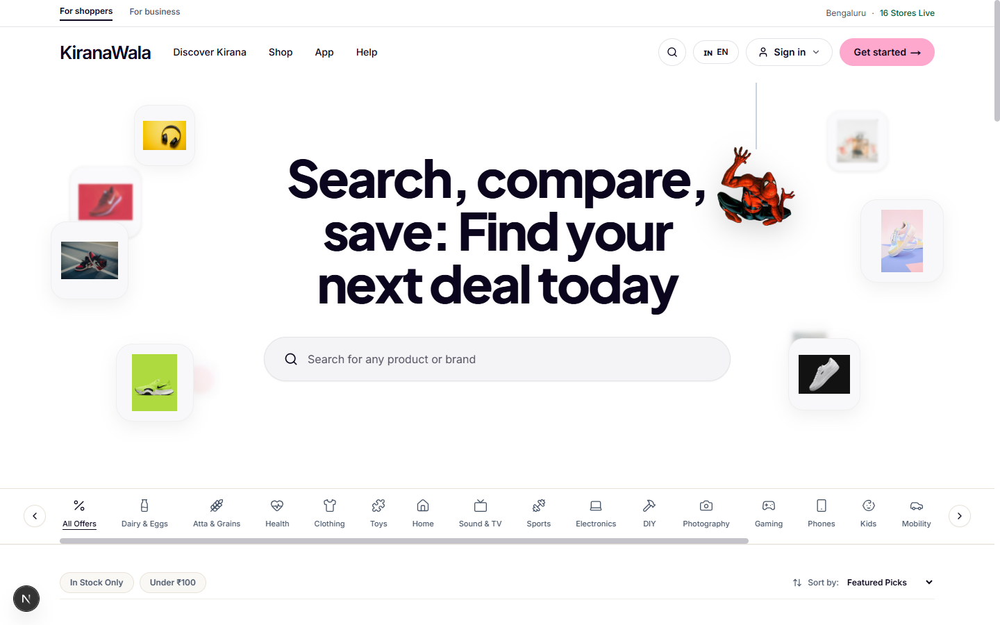
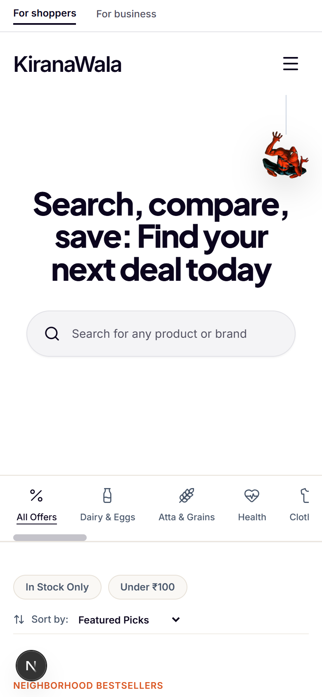

# KiranaWala

**Hyperlocal Smart Grocery Commerce Platform**

KiranaWala is a full-stack grocery commerce application designed to connect customers with neighbourhood stores. It brings store discovery, product catalogues, cart and checkout, payments, inventory operations, order fulfilment, and AI-assisted shopping into one platform.

- **Live application:** https://kirana-wala-1nhp.vercel.app
- **Backend deployment:** https://kiranawala-api.onrender.com
- **Source code:** https://github.com/Jyatin/KiranaWala
- **QA matrix:** [TEST_CASES.md](./TEST_CASES.md)

> **Project scope:** KiranaWala is a deployed portfolio project. The repository includes demo-seeding utilities and some integrations that depend on external credentials. A feature being present in the code does not, by itself, mean every production-scale failure path has been verified.

---

## Contents

- [Product overview](#product-overview)
- [Features](#features)
- [Architecture](#architecture)
- [Core workflows](#core-workflows)
- [Engineering decisions and limitations](#engineering-decisions-and-limitations)
- [Technology stack](#technology-stack)
- [API overview](#api-overview)
- [Repository layout](#repository-layout)
- [Getting started](#getting-started)
- [Environment variables](#environment-variables)
- [Demo data](#demo-data)
- [Testing and QA](#testing-and-qa)
- [Deployment](#deployment)
- [Known limitations and next steps](#known-limitations-and-next-steps)
- [What this project demonstrates](#what-this-project-demonstrates)
- [Author](#author)

---

## Product overview

Traditional neighbourhood grocery stores may lack integrated digital catalogues, online ordering, inventory visibility, and customer-facing fulfilment tools. KiranaWala explores how a shared digital platform can support both sides of local commerce.

### Customer experience

Customers can discover stores, search and filter grocery products, review product details, manage a cart, apply eligible coupons, place orders, complete payment flows, and follow order status. An AI-assisted shopping experience helps translate natural-language requests into relevant catalogue discovery.

### Store and fulfilment operations

Store-owner routes support store and product management, inventory updates, and order workflows. Dedicated delivery routes support delivery partners in finding available orders, claiming work, and advancing fulfilment status.

### Demo catalogue

The repository's seed script is designed to populate **20 Bengaluru demo stores and 200+ grocery products**. This is seeded sample data, not a claim that 20 independent merchants are actively operating on the live deployment.

---

## Features

### Customer shopping

- Store and product discovery, including search and category filtering.
- Store-level product browsing and product detail views.
- Cart and checkout workflows with server-side validation.
- Coupon discovery and validation for eligible orders.
- Customer order history, status tracking, and dashboard views.
- Product/store feedback routes for 1–5 star ratings and comments; the route attempts to verify prior purchases/orders and recalculates product average ratings. The current route/model field mismatch means this is not yet verified end-to-end.
- Responsive layouts and loading, empty, and error states documented in the QA matrix.

### Store-owner operations

- Store-owner authentication and protected management routes.
- Store profile and product catalogue management.
- Inventory updates and order fulfilment workflows.
- Server-side role and ownership checks for protected operations.

### Delivery-partner workflow and lifecycle

The **Order** model records the customer-facing commerce/fulfilment status. The store-owner route allows transitions through states such as `placed → confirmed → packing → ready`; delivery assignment and progress can then move the order through `assigned → picked_up → out_for_delivery → delivered`. Some transitions are also allowed from `processing`, and terminal states include `delivered`, `completed`, and `cancelled`. The exact allowed transitions are enforced by `ALLOWED_ORDER_TRANSITIONS` in `server/routes/storeRoutes.js` and `VALID_DELIVERY_TRANSITIONS` in `server/routes/deliveryRoutes.js`; they are not one universal linear state machine.

The separate **Delivery** model represents the delivery task itself. Its schema defines `unassigned`, `assigned`, `accepted`, `heading_to_store`, `arrived_at_store`, `picked_up`, `out_for_delivery`, `delivered`, `failed`, and `cancelled`. These are conceptually distinct from the Order status, even though the delivery status route attempts to mirror some status updates onto both records. The delivery model also carries partner, pickup/drop-off address, distance/ETA, earning, OTP, and location fields.

Delivery partners can list ready/unassigned orders, claim an eligible order, and progress assigned work. The order route checks assignment for delivery-partner callers and validates an OTP on the delivered transition. **Integration caveat:** the claim upsert currently writes fields such as `runner`, `dropoffAddress`, and `earnings`, while the Delivery schema expects `partner`, `dropAddress`, and `earningAmount`; the status update also assumes the Delivery record exists. Therefore the Order lifecycle is more directly represented than a fully functioning, synchronised Delivery-model lifecycle. Treat this as workflow code requiring route/model alignment and end-to-end tests—not proof of live courier dispatch, route optimisation, or continuous GPS tracking.

### Payments and promotions

- Razorpay order creation and server-side payment verification.
- Payable amount derived on the backend rather than trusted from client input.
- HMAC-SHA256 verification for payment signatures.
- Coupon validation for validity dates, minimum order value, store applicability, and usage limits.
- Webhook event ledger with duplicate-event detection and retry-aware processing.
- Refund event handling in the webhook workflow.

The webhook ledger reduces duplicate event processing but does not make all order and inventory side effects one atomic distributed transaction. See [Engineering decisions and limitations](#engineering-decisions-and-limitations).

### AI-assisted shopping

KiranaWala uses Google's `@google/generative-ai` SDK with **Gemini 1.5 Flash** by default (`server/services/ai/aiProviderAdapter.js`). `GEMINI_API_KEY` is read server-side; it is not intended for the browser. The provider adapter configures a system instruction, safety thresholds, a low temperature, a response-token limit, and Gemini function calling in `AUTO` mode.

The implementation is split into four layers:

1. **Provider adapter —** creates a stateful Gemini chat session and keeps provider-specific SDK usage in one module.
2. **Orchestrator —** `server/services/ai/aiService.js` declares the available function schemas, processes function-call responses, sends tool results back to Gemini, and caps the loop at five tool iterations.
3. **Read-only tool layer —** `server/services/ai/aiTools.js` executes only the application's declared database reads. Tools include product search, nearby-store discovery, product detail/availability lookup, and shopping-intent basket suggestions. They do not create orders, update inventory, or mutate customer data.
4. **Route and validation boundary —** `POST /api/customer/ai/chat` is JWT-authenticated and customer-role protected. It validates a non-empty message (maximum 2,000 characters), applies an in-memory rate limit, and returns a shaped response rather than raw provider output or internal reasoning.

Tool inputs are validated before database access: product/store IDs are checked, coordinates must be within latitude/longitude bounds, product search results are capped at 20 (default 10), and nearby-store radius defaults to 8 km with a 50 km maximum. The tool layer projects safe product/store fields instead of exposing raw MongoDB documents. These controls reduce the model's authority, but do not replace normal backend validation for cart, checkout, pricing, inventory, or authorization.

### Customer feedback, notifications, and subscriptions — status and boundaries

- **Purchase-aware customer feedback:** the review route accepts a 1–5 star rating and comment for a product and/or store, attempts to verify the customer has a qualifying prior order, and calculates an average product rating. However, the route writes fields such as `customer`, `title`, and `status`, while the Mongoose model requires `user`, `userName`, and `order` and uses `isApproved`. This mismatch means the intended purchase-aware rating/comment flow needs contract alignment and tests before it can be called operational end-to-end.
- **In-app notifications:** authenticated endpoints retrieve the latest 30 notifications for the signed-in user, return an unread count, mark one notification as read, and mark all of that user's notifications as read. These are retrieval and read/unread management features; the routes do not implement push, SMS, email, or WhatsApp delivery.
- **Recurring-order configuration:** customers can list, create, pause, resume, or cancel subscription records in the intended API. The model captures frequency (`daily`, `alternate_days`, `weekly`, `monthly`), preferred time slot, delivery address, items, and next delivery date. The current create handler omits schema-required `title` and item `name` fields and uses mismatched names such as `deliverySlot`; no verified scheduler/order-generation worker is present. Describe this as recurring-order configuration only—**automatic recurring order creation and fulfilment are not implemented/verified end-to-end**.

These modules are included in the architecture, but route presence alone does not establish an operational end-to-end feature. The known route/model mismatches are documented under [Known limitations](#known-limitations-and-next-steps).

### Location-aware discovery

Store documents support GeoJSON point coordinates and a MongoDB 2dsphere index. Location-aware discovery and distance-based results are used in parts of the application. This is not a claim of continuous customer tracking or turn-by-turn navigation.

---

## Architecture

```text
Customer / Store Owner / Delivery Partner
                    |
                    v
        Next.js + React + TypeScript
         Customer and store interfaces
                    |
                 REST API
                    |
                    v
           Node.js + Express
     Authentication / Authorization
     Validation / Commerce workflows
       |          |           |
       v          v           v
    MongoDB    Razorpay    Gemini API
  users, stores, payments   AI-assisted
  products, orders,         discovery
  inventory, coupons,
  reviews, subscriptions,
  notifications, webhook events
       |
       v
 Inventory, order and fulfilment
 state transitions
```

The frontend handles presentation and interaction. The backend is responsible for validating requests and making authoritative decisions about prices, inventory, permissions, payment state, and order state.

### Main domain models

The backend contains Mongoose models for users, stores, products, carts, orders, coupons, deliveries, reviews, notifications, subscriptions, and webhook events. Exact relationships and fields are defined in the model files under `server/models/`.

---

## Core workflows

### 1. Browse and build a basket

1. A customer opens store discovery or the product catalogue.
2. The application retrieves relevant stores/products and applies search or category filters.
3. The customer adds items to a cart and selects quantities.
4. The backend validates product and quantity information before accepting commerce operations.

### 2. Checkout and payment

1. The backend validates the order/cart data and calculates the authoritative payable amount.
2. Inventory reservation logic uses conditional database updates to check availability while reserving stock.
3. The payment service creates a Razorpay order when configured for the real provider, or uses its development mock provider only in non-production environments when credentials are unavailable.
4. The backend verifies the payment signature before accepting a successful payment transition.
5. Payment webhooks are checked against the configured webhook secret and recorded in a persistent event ledger.

### 3. Store and delivery fulfilment

1. Store-side workflows move an order through preparation and ready states.
2. A delivery partner can list eligible orders and claim an unassigned ready order.
3. Delivery status progresses through supported states.
4. The delivery endpoint checks the submitted OTP when marking an order delivered.

Exact transition rules are implemented in the route handlers. This workflow description is not a guarantee of a fully automated dispatch system.

### 4. AI-assisted catalogue discovery

1. A customer submits a natural-language shopping request.
2. The server-side AI service sends the request to Gemini with the configured system instructions and tool declarations.
3. The model may request a read-only catalogue/store tool.
4. Tool inputs are validated, database results are shaped into limited response objects, and results are returned to the conversation.
5. The service returns a final response and the tools used; it does not expose raw provider responses or tool arguments as its public response contract.

---

## Engineering decisions and limitations

### Inventory reservations, expiry, and concurrency

`server/services/inventoryService.js` implements temporary stock reservations with a default **15-minute TTL**. `reserveStock()` conditionally updates each product document only when the product is available and `availableStock >= requested quantity`; it decrements `availableStock` and increments `reservedStock`. The returned `expiresAt` timestamp represents the reservation deadline.

- **Checkout/payment succeeds:** `commitReservation()` moves reserved quantity out of `reservedStock` and increments sold/total stock counters.
- **Checkout fails part-way through reservation:** `reserveStock()` attempts compensating updates for products already reserved in that batch, returning those quantities to `availableStock` and decrementing `reservedStock`.
- **Payment fails or reservation is abandoned:** `releaseReservation()` restores available quantity and removes it from reserved stock.
- **Expiry cleanup:** `cleanupExpiredReservations()` searches for `pending_payment` orders older than 15 minutes, marks them `payment_failed`, appends a timeline note, saves the order, and then calls `releaseReservation()` for its items.

**Important scheduler caveat:** the cleanup function exists in the inventory service, but it is not wired to a scheduler/interval in `server/server.js` in the current branch. Therefore the code defines the expiry/release operation, but automatic periodic expiry should not be claimed until a worker or scheduler invokes it and that execution is tested. The routine also saves the failed order before releasing stock, so interruption between those steps can leave stock reserved unless a retry/reconciliation path handles it.

### Per-product atomicity is not cart-level atomicity

- **Per-product atomicity:** the conditional stock update checks availability and adjusts one product in a single database operation, helping prevent two requests from reserving the same remaining units.
- **Multi-product checkout:** a cart may touch several product documents. Atomic updates to each document do not make the entire cart all-or-nothing.
- **Compensating rollback:** restoring stock after a later item fails can itself fail or be interrupted. Compensation is not equivalent to a multi-document database transaction.
- **Verification boundary:** tests cover only the scenarios they exercise; they do not prove every possible interleaving or crash-recovery path.

Do not claim a guaranteed atomic commit/rollback for multi-item checkout unless a database transaction or complete recovery design is implemented and tested.

### Payment webhook idempotency

The webhook handler:
- requires the configured `RAZORPAY_WEBHOOK_SECRET`, signature header, event ID, and raw request body;
- validates the HMAC-SHA256 signature against the original request bytes;
- stores event IDs in a MongoDB ledger with a unique index;
- tracks processing states (`processing`, `processed`, and `failed`);
- returns non-2xx responses for processing failures so the provider can retry.

The raw-body middleware is registered before the general JSON parser. The ledger helps detect duplicate events, but **exactly-once side effects are not guaranteed**. A crash between an order update and a separate side effect—such as refund-related stock restoration—can leave partial state. Automated reconciliation against Razorpay's authoritative payment state remains future work.

### Route/model integration gaps

The repository currently contains some cross-layer contract mismatches that should be resolved before claiming every route is production-ready:

- **Reviews:** the create handler writes fields such as `customer`, `title`, and `status`, while the Mongoose schema requires `user`, `userName`, and `order` and uses `isApproved`. The list handlers also query an approval field that does not match the schema.
- **Subscriptions:** the create handler does not supply all required subscription and item fields (including `title` and item `name`) and uses `deliverySlot` / `subtotalPerDelivery` fields that are not defined in the schema.
- **Delivery:** the claim handler's upsert payload uses names and address shapes that do not fully match the Delivery model.

These are source-level observations, not claims that runtime tests have reproduced each failure. Align the contracts, add route-level integration tests, and then update this section based on verified behaviour.

### AI safety boundary

The AI database tool layer is intended to be read-only, validates tool inputs, limits query sizes, and shapes returned objects to avoid passing raw database documents to the model. AI output is not an authority for price, stock, payment status, or order state.

### Authentication and authorization

JWT-based authentication and role checks protect backend operations. Customer, store-owner, delivery-partner, and admin-specific behaviour should be assessed at the route level; a protected frontend view is not a substitute for backend authorization.

---

## Technology stack

| Layer | Technology |
|---|---|
| Frontend | Next.js, React, TypeScript |
| Styling and UI | Tailwind CSS, Lucide icons, Motion/GSAP in relevant UI areas |
| Backend | Node.js, Express |
| Data access | Mongoose |
| Database | MongoDB / MongoDB Atlas |
| Authentication | JWT, bcryptjs |
| Payments | Razorpay integration and a development-only mock provider |
| AI | Google Gemini SDK, server-side adapter and tool calling |
| API style | REST |
| Backend testing | Jest, Supertest, mongodb-memory-server in the test setup |
| Frontend hosting | Vercel |
| Backend hosting | Render |
| CI configuration | GitHub Actions workflow(s) in `.github/workflows/` |

Dependency versions and scripts are defined in the root and `server/package.json` files.

---

## API overview

The Express server mounts the following route groups. Individual endpoints have different authentication requirements; check the route handler and middleware before calling them.

| Base path | Responsibility |
|---|---|
| `/api/customer` | Customer registration/login, customer-facing store/product/cart/order operations |
| `/api/customer/ai` | Authenticated AI shopping chat |
| `/api/store` | Store operations |
| `/api/store-owner` | Store-owner operations (same route module mounted under this prefix) |
| `/api/coupons` | Coupon listing, validation, and management endpoints |
| `/api/payments` | Payment-order creation, payment verification, and Razorpay webhook |
| `/api/delivery` | Delivery-partner order discovery, claiming, and status transitions |
| `/api/reviews` | Product/store review submission and retrieval |
| `/api/notifications` | Notification listing and read-state management |
| `/api/subscriptions` | Recurring subscription creation, listing, and status management |

### Important payment endpoints

- `POST /api/payments/create-order` — creates a payment order for an authenticated customer's order.
- `POST /api/payments/verify` — verifies the payment through the payment service.
- `POST /api/payments/webhook` — receives Razorpay webhook events; signature verification requires the raw request body and configured webhook secret.

#### Endpoint index

Paths below are relative to the route-group base path. Authentication/role middleware and request validation vary by endpoint; inspect the linked route source before calling a protected route. This is a source-derived index, not an OpenAPI contract.

| Group | Endpoints |
|---|---|
| Customer (`/api/customer`) | `POST /register`, `POST /login`, `GET /me`, `GET /stores`, `GET /stores/nearby`, `GET /stores/:storeId`, `GET /stores/:storeId/products`, `GET /products/search`, `GET /products/compare`, `GET /cart`, `POST /cart/items`, `PATCH /cart/items/:productId`, `DELETE /cart/items/:productId`, `DELETE /cart`, `POST /cart/basket`, `GET /cart/smart-optimization`, `POST /orders`, `GET /orders`, `GET /orders/:orderId`, `PATCH /orders/:orderId/cancel` ([source](./server/routes/customerRoutes.js)) |
| Store / store owner (`/api/store`, `/api/store-owner`) | `POST /register`, `POST /login`, `POST /products`, `GET /products/:storeId`, `PUT /products/:productId`, `DELETE /products/:productId/:storeId`, `GET /all`, `GET /:storeId/products`, `GET /orders`, `GET /orders/:orderId`, `PATCH /orders/:orderId/status`, `GET /analytics`, `GET /intelligence/demand-forecast`, `POST /intelligence/ai-manager`, `PATCH /inventory/update`, `GET /catalog`, `PATCH /store/status`, `GET /me` ([source](./server/routes/storeRoutes.js)) |
| AI (`/api/customer/ai`) | `POST /chat` ([source](./server/routes/aiRoutes.js)) |
| Coupons (`/api/coupons`) | `GET /`, `POST /validate`, `POST /create` ([source](./server/routes/couponRoutes.js)) |
| Payments (`/api/payments`) | `POST /create-order`, `POST /verify`, `POST /webhook`, `POST /failure`, `POST /refund` ([source](./server/routes/paymentRoutes.js)) |
| Delivery (`/api/delivery`) | `GET /orders`, `GET /available`, `PATCH /orders/:id/claim`, `PATCH /orders/:id/status`, `GET /orders/:id/track`, `GET /earnings` ([source](./server/routes/deliveryRoutes.js)) |
| Reviews (`/api/reviews`) | `POST /`, `GET /product/:productId`, `GET /store/:storeId` ([source](./server/routes/reviewRoutes.js)) |
| Notifications (`/api/notifications`) | `GET /`, `PATCH /:id/read`, `POST /mark-all-read` ([source](./server/routes/notificationRoutes.js)) |
| Subscriptions (`/api/subscriptions`) | `GET /`, `POST /`, `PATCH /:id/status` ([source](./server/routes/subscriptionRoutes.js)) |

### Screenshots

The repository includes desktop and mobile shop screenshots. They are checked-in visual references, not automatically refreshed screenshots from the current live deployment.

| Desktop shopping view | Mobile shopping view |
|---|---|
|  |  |

For request bodies, response schemas, and access rules, inspect the corresponding route source files linked above. A complete OpenAPI schema is not currently maintained.

---

## Repository layout

```text
KiranaWala/
├── .github/workflows/       # CI workflow configuration
├── src/
│   ├── app/                 # Next.js App Router pages
│   ├── components/          # Reusable UI components
│   └── ...                  # Frontend modules
├── server/
│   ├── models/              # Mongoose domain models
│   ├── routes/              # Express route handlers
│   ├── services/            # Payment, inventory, coupon and AI services
│   ├── middleware/          # Authentication/authorization middleware
│   ├── scripts/             # Demo data seeding
│   └── __tests__/           # Backend Jest tests
├── public/                  # Public/static and legacy assets
├── views/                   # Express-served HTML views
├── docker-compose.yml       # Existing multi-service configuration
├── package.json             # Frontend/root scripts and dependencies
├── server/package.json      # Backend scripts and dependencies
├── TEST_CASES.md            # Manual/integration QA matrix
└── README.md
```

The repository contains both the Next.js frontend and legacy public/Express-served assets. The Docker Compose configuration now builds the current Next.js app from the repository root using `Dockerfile.frontend`; `public/Dockerfile` remains only for the legacy static assets.

---

## Getting started

### Prerequisites

- A supported Node.js runtime and npm.
- MongoDB locally or a MongoDB Atlas connection string.
- Gemini API key if you want to use the AI chat feature.
- Razorpay credentials for real Razorpay integration; development mock payments are available only in non-production mode when real credentials are not configured.

### 1. Clone and install

```bash
git clone https://github.com/Jyatin/KiranaWala.git
cd KiranaWala
npm install
npm install --prefix server
```

The root install prepares the Next.js application. The second install prepares the separately configured Express backend and its test dependencies.

### 2. Configure the backend environment

Create `server/.env` using `server/.env.example` as a starting point. Fill in the required values for your environment. Do not commit the real `.env` file.

See [Environment variables](#environment-variables) below.

### 3. Start MongoDB

Start your local MongoDB instance or configure `MONGO_URI` to point to a database you are authorised to use.

### 4. Run the backend

In one terminal:

```bash
npm run server
```

The Express server defaults to port `3000` unless `PORT` is configured. If you run the backend and frontend on the same port, resolve the conflict by configuring distinct ports and the frontend's API target as appropriate.

### 5. Run the Next.js frontend

In another terminal:

```bash
npm run dev
```

Next.js uses its default development port unless it is already occupied. Confirm the frontend's API base URL/configuration matches the backend address in your local setup.

### 6. Seed demo data (optional)

After configuring the database, you can run:

```bash
npm run seed
```

**Warning:** review the seed script before running it against any database containing data you need to preserve. Use a dedicated development database for demo data.

---

## Environment variables

The Express backend loads `server/.env` explicitly from `server/server.js`. Copy the example file with `cp server/.env.example server/.env`, then edit it. The Next.js frontend is started from the repository root; do not put server-only secrets in `NEXT_PUBLIC_*` variables or frontend code. Payment configuration is read by the backend even though the example file currently lists only the core variables.

| Variable | Purpose | Required when |
|---|---|---|
| `MONGO_URI` | MongoDB connection string | Required for a configured persistent database; production startup cannot use a local fallback |
| `JWT_SECRET` | JWT signing secret | Required for secure deployments; never use a guessable default in production |
| `PORT` | Express listening port | Optional; server defaults to 3000 |
| `GEMINI_API_KEY` | Gemini API key | Required for the AI chat feature; other API routes can run without it |
| `RAZORPAY_KEY_ID` | Razorpay API key ID | Required with the key secret for real Razorpay order/payment integration |
| `RAZORPAY_KEY_SECRET` | Razorpay API secret | Required with the key ID for real payment integration and payment signature verification |
| `RAZORPAY_WEBHOOK_SECRET` | Secret configured for Razorpay webhook signing | Required to verify incoming Razorpay webhook events |

Use placeholders in documentation and a secret manager or deployment environment variables for actual credentials. Never commit API keys, database passwords, webhook secrets, or production credentials.

---

## Demo data

The seeding script describes a demo catalogue of 20 Bengaluru stores and more than 200 grocery products. It also seeds related commerce data according to the script's implementation.

- Use a separate development database for demo data.
- Treat seeded stores/products as sample records, not independently verified live merchants.
- Do not run seed scripts against a production database without reviewing their behaviour and confirming the intended effect.
- External product images may depend on the image provider and network availability.

---

## Testing and QA

The backend uses Jest and runs tests sequentially with `jest --runInBand`.

### Run the backend tests

From the repository root:

```bash
npm test
```

Or from the backend directory:

```bash
cd server
npm test
```

The root `test` script delegates to the backend suite using `npm --prefix server test`. It does **not** run a separate frontend test suite.

### Test coverage areas

The current test files include backend tests relating to:

- Authentication, roles, and protected routes.
- Store and product behaviour and product model validation.
- Cart, checkout, and order workflows.
- Coupon and discount validation.
- Inventory behaviour and reservation scenarios.
- Payment order creation, signature validation, payment failures, and selected webhook cases.
- Webhook raw-body signature validation and persistent event-ID deduplication.
- AI service/tool behaviour, using mocked provider calls in tests where configured.
- Input validation, error handling, and database-backed API workflows.

### Test inventory vs. passing results

The feature branch README has recorded **220 Jest test declarations across 18 backend test files** and **217 scenarios** in [TEST_CASES.md](./TEST_CASES.md). The QA matrix records its last execution date and per-scenario status inside that file.

These counts are inventory metrics, not code coverage and not proof that every test currently passes. A test declaration only proves that a test is defined. Re-run the suite against the current commit before reporting a fresh pass rate.

The QA matrix includes manual, automated, and combined scenarios. Manual-only scenarios still require browser/user validation.

### Webhook test scope

The documented webhook tests cover missing signatures, invalid signatures, and repeated event IDs. Further valuable tests include concurrent duplicate deliveries, retry after processing failure, stale processing recovery, and failures between order updates and stock side effects.

See [TEST_CASES.md](./TEST_CASES.md) for the detailed scenario matrix.

---

## Deployment

The repository's documented hosting setup is:

| Component | Platform / service |
|---|---|
| Frontend | Vercel |
| Backend | Render |
| Database | MongoDB Atlas (when configured) |
| Payment integration | Razorpay; use test credentials for development |
| CI | GitHub Actions configuration in the repository |

- **Live frontend:** https://kirana-wala-1nhp.vercel.app
- **Backend URL:** https://kiranawala-api.onrender.com

Configure backend environment variables in the deployment provider rather than committing secrets. Ensure the frontend points to the intended backend URL and that CORS settings match the deployed frontend.

### Docker Compose

The Compose frontend now builds from `Dockerfile.frontend` at the repository root, installs the root lockfile dependencies, runs `npm run build`, and serves the Next.js application with `npm start`. It no longer serves only `./public` through Nginx. The legacy `public/Dockerfile` remains available for static assets only.

```bash
cp server/.env.example server/.env
# Edit server/.env; for Compose, set MONGO_URI to mongodb://mongo:27017/kiranawala
# Keep JWT_SECRET and any optional provider credentials configured.
docker compose up --build
```

With the current Compose port mappings, open the frontend at `http://localhost:3001` and the Express API at `http://localhost:3000`. The frontend's API base URL must point at the backend address reachable from the browser; if the current frontend build uses a deployed API URL, local Compose does not automatically rewrite that URL. Confirm the app's API configuration before treating the local stack as a fully integrated environment. The Compose image/build configuration has been updated in source; a successful Docker build and browser smoke test still need to be recorded separately.

---

## Known limitations and next steps

The following are explicit boundaries to keep the project's claims accurate:

1. **No complete payment reconciliation worker:** divergence between Razorpay and application payment/order state is not automatically reconciled by a dedicated worker.
2. **Webhook side effects are not one distributed transaction:** a crash between related writes can leave partial state, even when event IDs are deduplicated.
3. **Multi-item inventory is not automatically transactionally atomic:** per-product conditional updates do not guarantee an all-or-nothing cart reservation.
4. **Review route/schema contract needs alignment:** review creation and listing handlers do not currently match the review schema's required fields and approval field.
5. **Subscription route/schema contract needs alignment:** the creation handler does not currently populate all schema-required fields and uses fields not declared in the schema.
6. **Delivery route/model contract needs alignment:** the delivery claim upsert uses field names/shapes that differ from the Delivery model; order status and delivery-task status should be reconciled and tested independently.
7. **Reservation expiry scheduling is not wired:** `cleanupExpiredReservations()` defines cleanup of pending-payment orders older than 15 minutes, but no scheduler invocation is wired in `server/server.js`; expiry is not proven to run automatically.
8. **Subscription automation needs separate verification:** a complete scheduled order-generation and fulfilment pipeline should not be claimed without verifying the worker/scheduler.
9. **Frontend automated tests are not included in the root test command:** `npm test` runs the backend Jest suite.
10. **Docker validation is pending:** Compose now targets the current Next.js frontend, but image build, container startup, browser smoke test, and local frontend-to-API connectivity have not yet been verified in this environment.
11. **Live merchant claims must be evidence-based:** seeded demo data and local workflow feedback should be described separately from independently verified active merchants.

These limitations are useful engineering discussion points: they identify the difference between implemented workflows and stronger reliability guarantees.

---

## What this project demonstrates

KiranaWala brings together several practical full-stack engineering concerns:

- Designing a multi-role commerce application and REST API.
- Modelling users, stores, products, carts, orders, inventory, and related domain records.
- Enforcing backend validation and authorization boundaries.
- Integrating payment-provider order creation and cryptographic signature checks.
- Handling webhook retries with a persistent event ledger while documenting the remaining consistency gaps.
- Designing inventory reservations and reasoning about concurrency and rollback.
- Integrating a server-side LLM with bounded tool calling and read-only data access.
- Maintaining automated backend tests and a structured manual QA matrix.
- Evaluating product workflows against realistic neighbourhood-store scenarios.

---

## Author

**Jyatin Singh**

- GitHub: https://github.com/Jyatin
- LinkedIn: https://www.linkedin.com/in/jyatinsingh/

---

*Built to explore better digital commerce for neighbourhood grocery stores.*
