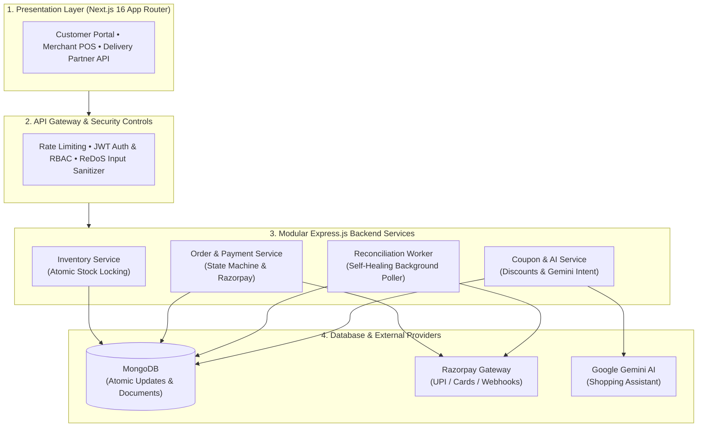
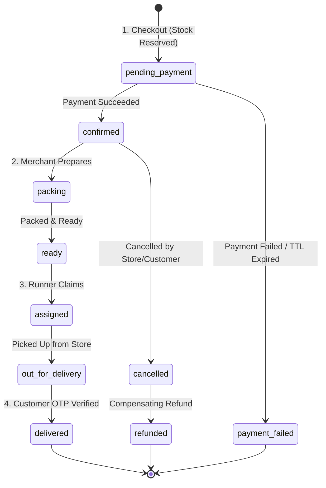
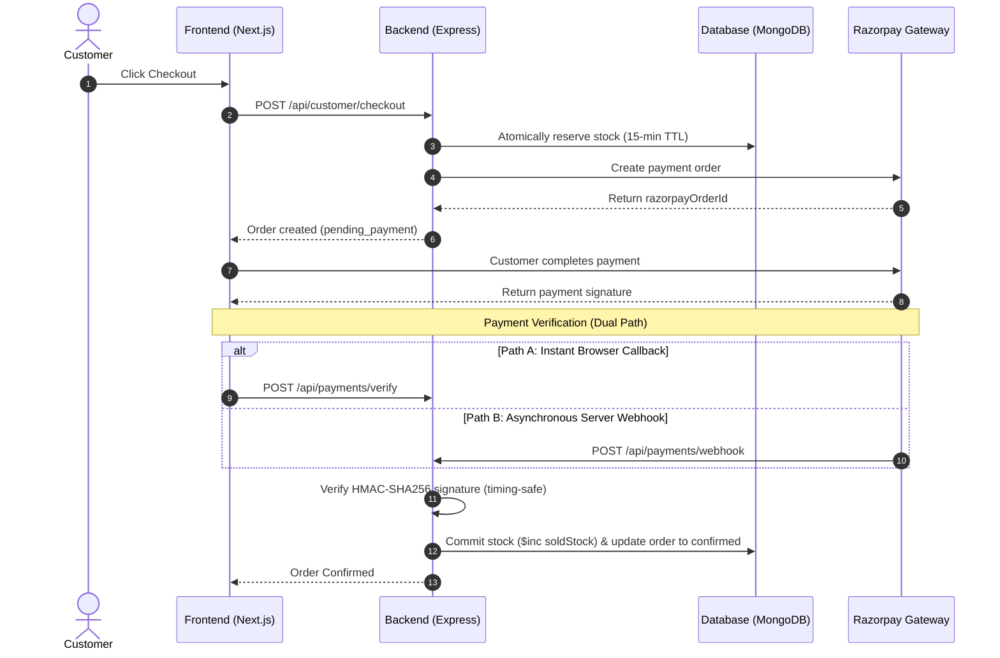
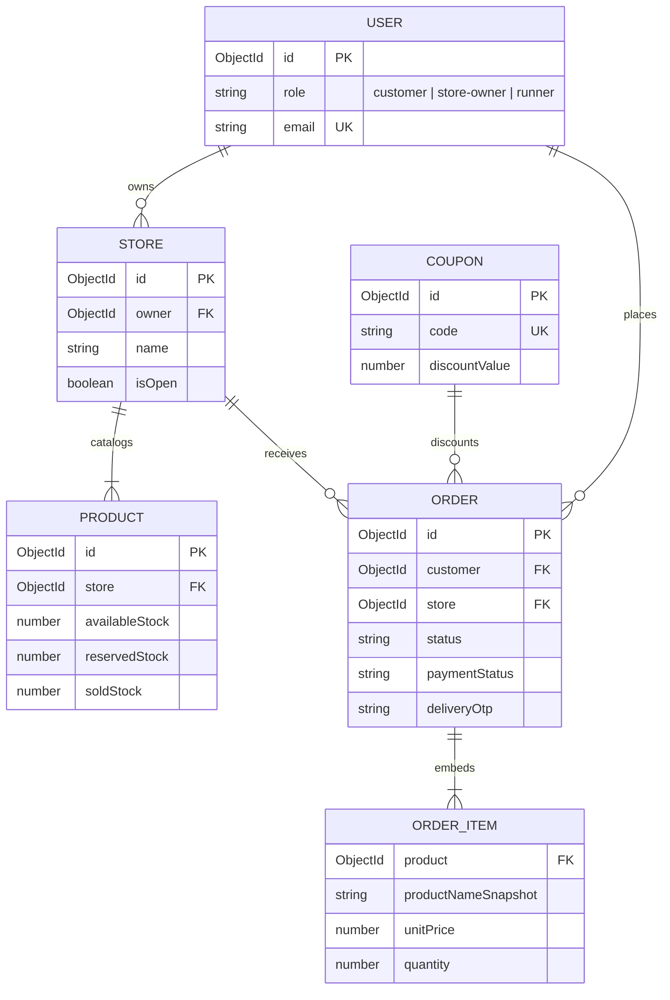

# 🛒 KiranaWala — Hyperlocal Smart Grocery Commerce Platform

[](https://github.com/Jyatin/KiranaWala/actions/workflows/node.js.yml)
[](https://github.com/Jyatin/KiranaWala/actions/workflows/lint.yml)
[](https://nodejs.org/)
[](https://nextjs.org/)
[](https://expressjs.com/)
[](https://www.typescriptlang.org/)
[](https://www.mongodb.com/)
[-success.svg)](https://jestjs.io/)
[-blueviolet.svg)](./QA_REPORT.md)
[](./package.json)

> **A production-oriented hyperlocal grocery platform featuring backend-authoritative pricing, atomic inventory reservations, timing-safe Razorpay HMAC verification, and role-segregated fulfillment workflows.**

- **Live Application:** [https://kirana-wala-1nhp.vercel.app](https://kirana-wala-1nhp.vercel.app)
- **Merged Hardening Pull Request:** [PR #36: Security Hardening & Infrastructure Upgrade](https://github.com/Jyatin/KiranaWala/pull/36)
- **Comprehensive QA Report:** [QA_REPORT.md](./QA_REPORT.md)
- **Full REST API Reference:** [docs/API_REFERENCE.md](./docs/API_REFERENCE.md)

---

## ⚡ 30-Second Executive Summary

### What is KiranaWala?
KiranaWala digitizes traditional Indian neighborhood grocery stores (*Kiranas*). It gives local merchants an easy-to-use digital storefront, allows neighborhood shoppers to discover nearby stores and place orders with stock visibility, and coordinates local delivery partners with secure, verified handshakes.

**Why I built this:** Built after talking with neighborhood grocery owners in Indirapuram about how they run inventory and fulfillment.

### Why does it stand out from a standard e-commerce project?
Most sample e-commerce applications trust the browser for totals, suffer from overselling when multiple shoppers check out at once, and break if a payment webhook drops. KiranaWala solves these real-world backend engineering challenges with enterprise-grade safeguards:

| Engineering Dimension | Naive E-Commerce Pattern | KiranaWala Production Implementation |
|---|---|---|
| **Price Calculations** | Calculates subtotals, delivery fees, and discounts on the client. | **Zero-trust server calculation:** The browser sends only product IDs and quantities; all prices, fees, and coupons are fetched and calculated on the backend. |
| **Inventory Concurrency** | Checks stock first, then decrements in a separate database query (vulnerable to race conditions). | **Atomic conditional updates:** Decrements inventory directly in MongoDB (`$inc` with `$gte`) in a single step, making double-selling physically impossible. |
| **Payment Integrity** | Relies on basic frontend callback flags to confirm payment. | **Cryptographic verification:** Verifies Razorpay signatures against raw request buffers using timing-safe comparisons (`crypto.timingSafeEqual`). |
| **Dropped Webhooks** | Orders stay permanently stuck if a payment webhook drops or arrives late. | **Self-healing background worker:** Polls Razorpay for orphaned payments every 5 minutes and automatically updates order status. |
| **Delivery Handshake** | Delivery runners self-report when an order is completed. | **Customer-held OTP:** The driver cannot mark an order delivered without a 4-digit code provided verbally by the recipient, protected by brute-force lockout. |
| **Automated Testing** | Little to no backend test coverage. | **100% test pass rate:** 36 automated Jest suites with 301 unit, integration, concurrency, and security regression tests. |

---

## 📑 Table of Contents

1. [Application Interface Demonstrations](#1-application-interface-demonstrations)
2. [System Architecture](#2-system-architecture)
3. [End-to-End System Workflows](#3-end-to-end-system-workflows)
   - [A. Product Discovery & Store Browsing](#a-product-discovery-store-browsing)
   - [B. Cart & Single-Store Checkout](#b-cart-single-store-checkout)
   - [C. Order State Machine](#c-order-state-machine)
   - [D. Payment Lifecycle & Webhook Processing](#d-payment-lifecycle-webhook-processing)
   - [E. Authentication & Role-Based Access Control](#e-authentication-role-based-access-control)
   - [F. Delivery Handshake & OTP Verification](#f-delivery-handshake-otp-verification)
   - [G. Coupon Validation & Abuse Prevention](#g-coupon-validation-abuse-prevention)
4. [Database Design & Data Consistency](#4-database-design-data-consistency)
5. [Security Engineering & Hardening Matrix](#5-security-engineering-hardening-matrix)
6. [Testing, Quality & CI Pipelines](#6-testing-quality-ci-pipelines)
7. [Technology Stack & Architectural Rationale](#7-technology-stack-architectural-rationale)
8. [Local Development Setup](#8-local-development-setup)
9. [Core REST API Reference](#9-core-rest-api-reference)
10. [Deployment & Production Operations](#10-deployment-production-operations)
11. [Engineering Trade-offs & Deep-Dives](#11-engineering-trade-offs-deep-dives)
12. [Codebase Exploration Guide](#12-codebase-exploration-guide)

---

## 1. Application Interface Demonstrations

These screenshots use seeded demo data.

<table>
  <tr>
    <td align="center" width="25%">
      
      <sub><b>1. Storefront</b><br/>Seeded neighborhood stores, categories, and delivery options.</sub>
    </td>
    <td align="center" width="25%">
      
      <sub><b>2. Cart & Checkout</b><br/>Demo cart, checkout totals, and coupon flow.</sub>
    </td>
    <td align="center" width="25%">
      
      <sub><b>3. Merchant Dashboard</b><br/>Demo order queue and inventory management.</sub>
    </td>
    <td align="center" width="25%">
      
      <sub><b>4. Order Tracking</b><br/>Demo fulfillment timeline and delivery OTP interface.</sub>
    </td>
  </tr>
</table>

---

## 2. System Architecture

KiranaWala uses a decoupled multi-tier architecture that separates the user-facing web application from the core commerce API and database services.

### High-Level Architecture Diagram



### Architectural Layer Responsibilities

1. **Presentation Layer (Next.js 16 App Router):**
   - Renders fast, responsive user interfaces across mobile and desktop browsers.
   - Manages localized UI state, cart drawer interactions, and customer feedback.
   - Deployed on Vercel's global edge network for rapid initial page loads.

2. **Security & Perimeter Layer (Express Middleware):**
   - **Rate Limiting:** Protects login, registration, and checkout endpoints from credential stuffing and automated bot abuse.
   - **JWT Authentication & RBAC:** Verifies token signatures and enforces role boundaries (`customer`, `store-owner`, `delivery-partner`, `admin`).
   - **Input Sanitization:** Escapes regex metacharacters in search queries to block polynomial ReDoS attacks.

3. **Core Commerce Backend (Express.js 5 / Node.js 20 LTS):**
   - Encapsulates critical business logic in modular services (`InventoryService`, `PaymentService`, `CouponService`, `ReconciliationService`).
   - Runs as a long-lived Node.js service (Render/Docker) capable of maintaining active MongoDB connection pools and scheduled background workers.

4. **Data & External Integrations:**
   - **MongoDB 6:** Handles document persistence, flexible order snapshots, and atomic inventory mutations.
   - **Razorpay Payment Gateway:** Manages UPI, Netbanking, and Card transactions with webhook callbacks.
   - **Google Gemini SDK:** Powers the intelligent conversational shopping assistant.

---

### Repository Structure

```text
KiranaWala/
├── .github/
│   └── workflows/
│       ├── node.js.yml            # CI: Backend tests, TypeScript check, Next.js build
│       └── lint.yml               # CI: ESLint code hygiene verification
├── docs/
│   ├── API_REFERENCE.md           # Exhaustive REST API reference documentation
│   ├── AUDIT_BASELINE.md          # Architectural audit baseline record
│   ├── PAYMENT_INVENTORY_CODE_REVIEW.md # In-depth consistency review
│   └── screenshots/               # Verified real application screenshots
├── server/
│   ├── __tests__/                 # 36 Jest test suites (301 automated tests)
│   ├── config/
│   │   ├── env.js                 # Fail-fast startup environment validator
│   │   └── jwt.js                 # Centralized production JWT configuration
│   ├── middleware/
│   │   ├── authMiddleware.js      # JWT verification & RBAC role guards
│   │   └── rateLimitMiddleware.js # Sliding-window IP rate limiter
│   ├── models/                    # Mongoose schemas (Order, Product, User, Store, etc.)
│   ├── routes/                    # Express REST route controllers
│   ├── scripts/
│   │   └── seedDemoData.js        # Environment-gated database seeder
│   ├── services/
│   │   ├── inventoryService.js    # Atomic stock reservation & cleanup
│   │   ├── paymentService.js      # Razorpay client & state machine coordinator
│   │   ├── reconciliationService.js # Autonomous payment healing worker
│   │   └── couponService.js       # Coupon validation rules engine
│   ├── utils/
│   │   ├── orderStateMachine.js   # Order & payment status transition validators
│   │   └── sanitize.js            # ReDoS-safe regex escaping utility
│   ├── Dockerfile                 # Multi-stage Node.js 20 production container
│   ├── package.json               # Backend dependencies (Express 5, Mongoose 8)
│   └── server.js                  # Express application entry point & raw body mounts
├── src/                           # Next.js 16 App Router frontend application
│   ├── app/                       # Application pages (Customer, Merchant, Delivery, Help)
│   ├── components/                # Reusable UI components & navigation drawers
│   └── lib/                       # Client auth helpers and API utilities
├── docker-compose.yml             # Local multi-container Docker development stack
├── package.json                   # Root package.json (type-check, build, test scripts)
├── QA_REPORT.md                   # Full pre-deployment QA & audit verification report
└── README.md                      # Primary technical documentation
```

---

## 3. End-to-End System Workflows

### A. Product Discovery & Store Browsing
- **Neighborhood Discovery:** Customers can filter stores by neighborhood area (e.g., HSR Layout, Indiranagar, Koramangala, Whitefield) or store specialty.
- **ReDoS Protection:** Search strings are sanitized through `escapeRegex()` before querying MongoDB, preventing user inputs containing regex metacharacters (`.*+?^${}()|[]\`) from causing CPU exhaustion.
- **Privacy Protection:** Public store queries use explicit projections (`select: "name category location address owner"`) to ensure store owner email addresses, phone numbers, and password hashes are never returned to the frontend.

### B. Cart & Single-Store Checkout
1. **Single-Store Invariant:** A neighborhood Kirana fulfills its own orders locally. Carts cannot mix items from multiple stores. If a customer attempts to add an item from Store B while holding items from Store A, the backend rejects checkout with a `400 CROSS_STORE_CONFLICT` error.
2. **Server-Authoritative Pricing:** The checkout request body accepts only `productId` and `quantity`. The backend fetches live prices directly from MongoDB:
   $$\text{Subtotal} = \sum (\text{databasePrice}_i \times \text{quantity}_i)$$
   $$\text{Total Payable} = \text{Subtotal} + \text{DeliveryFee} - \text{ValidatedDiscount}$$
3. **Delivery Fee Rules:** Standard delivery fee is ₹30 for orders below ₹499, and free for orders ₹499 and above.

---

### C. Order State Machine

The order lifecycle follows an explicit state machine implemented in [orderStateMachine.js](server/utils/orderStateMachine.js):



#### How Each Role Interacts with the Order:
- **Customer:** Can cancel an order while it is still in `pending_payment` or `placed`. Holds the private 4-digit delivery OTP.
- **Store Owner:** Moves the order through preparation: `confirmed` → `packing` → `ready`. Can cancel if physical store stock is damaged or unavailable.
- **Delivery Runner:** Claims a `ready` order, picks it up, marks it `out_for_delivery`, and completes delivery by entering the customer's OTP.
- **Idempotency:** Re-sending an identical status update returns success without triggering duplicate actions or state errors.

---

### D. Payment Lifecycle & Webhook Processing



#### Why Dual Verification Exists:
- **Fast User Feedback (Path A):** When the customer finishes paying, the browser immediately calls `/api/payments/verify` so the user is instantly redirected to the order tracking screen without waiting for webhook latency.
- **Guaranteed Reliability (Path B):** If the customer closes their browser tab or loses network connectivity immediately after paying, Razorpay's asynchronous webhook notifies `/api/payments/webhook` directly.

#### Raw Request Buffer Preservation for Webhooks:
Razorpay generates its HMAC signature across the exact bytes of the incoming webhook body. Standard JSON body parsers format whitespace and reorder keys, which alters the binary data and causes cryptographic signature checks to fail. KiranaWala preserves the exact raw UTF-8 buffer by mounting `express.raw({ type: "*/*" })` exclusively on the webhook route in [server.js](server/server.js):
```javascript
app.use(
  "/api/payments/webhook",
  express.raw({ type: "*/*" }),
  (req, res, next) => {
    req.rawBody = req.body;
    next();
  }
);
```

#### Timing-Safe Cryptographic Comparison:
Signatures are validated using Node.js's built-in `crypto.timingSafeEqual` after checking byte lengths. This prevents timing side-channel attacks where an adversary measures microseconds to guess HMAC bytes sequentially.

---

### E. Authentication & Role-Based Access Control

- **Password Hashing:** Passwords are salted and hashed using `bcryptjs` with a work factor of 10.
- **JWT Protection:** Tokens are signed using HMAC-SHA256. [jwt.js](server/config/jwt.js) prevents the application from booting in production if `JWT_SECRET` is missing, shorter than 32 characters, or left as the development default.
- **Role Permissions:**
  - `customer`: Can place orders, manage personal cart, and track owned deliveries.
  - `store-owner`: Can edit store catalog, toggle store open/closed, and manage incoming orders.
  - `delivery-partner`: Can browse available deliveries, claim orders, and complete deliveries via OTP.
  - `admin`: Admin role (API-level access control).

---

### F. Delivery Handshake & OTP Verification

To prevent delivery drivers from marking an order as completed without actually handing the package to the customer:
1. **Secret Generation:** Upon order confirmation, the server generates a random 4-digit numeric OTP and stores it in the database with `select: false`.
2. **Strict Exposure Control:** The OTP is exposed **only** to the verified customer who placed the order via `GET /api/delivery/orders/:id/track`. It is strictly redacted from store owners, platform admins, and delivery runners.
3. **Physical Handshake:** When the runner arrives at the customer's doorstep, the customer reads the 4-digit code. The runner submits the code via `PATCH /api/delivery/orders/:id/status`.
4. **Brute-Force Lockout:** If an incorrect OTP is entered 5 times consecutively, verification is locked for 15 minutes (`otpLockedUntil`), protecting against automated guessing.

---

### G. Coupon Validation & Abuse Prevention

Coupon management in [couponService.js](server/services/couponService.js) enforces strict validation rules:
- **Rule Verification:** Checks coupon expiration date, active status flag, and minimum order values (`subtotal >= minOrderValue`).
- **Flexible Discount Types:** Supports `percentage` discounts (with optional maximum cap), `fixed` rupee deductions, and `free_delivery` fee waivers.
- **Abuse Prevention:** 
  - Validates overall usage limit (`usedCount < usageLimit`).
  - Enforces per-customer usage limits (default: 1 use per account).
  - Customer identity is extracted directly from verified JWT token claims rather than client request parameters, preventing ID spoofing.

---

## 4. Database Design & Data Consistency

### Simplified Entity-Relationship Diagram



### Key Data Architecture Decisions

1. **Embedded Historical Item Snapshots:**
   Each `ORDER` embeds an array of `ORDER_ITEM` documents containing the product's name and price at the exact moment of checkout. If a store owner changes a price or deletes a product next week, historical receipts and revenue reports remain unchanged.

2. **3-Counter Inventory Lifecycle:**
   Every product document tracks three discrete inventory numbers:
   - `availableStock`: Uncommitted stock available for purchase.
   - `reservedStock`: Stock temporarily held while the shopper completes payment (15-minute TTL).
   - `soldStock`: Permanently committed stock once payment is confirmed.

3. **Atomic Conditional Updates (Preventing Race Conditions):**
   Instead of reading stock and writing it back in two separate queries, KiranaWala executes atomic operations directly in MongoDB:
   ```javascript
   const updated = await Product.findOneAndUpdate(
     {
       _id: productId,
       available: true,
       availableStock: { $gte: quantity } // Condition: stock must be sufficient
     },
     {
       $inc: {
         availableStock: -quantity,       // Atomically decrease available
         reservedStock: quantity          // Atomically hold in reservation
       }
     },
     { new: true }
   );

   if (!updated) {
     throw new Error("Insufficient inventory for SKU");
   }
   ```
   Even if 100 shoppers try to buy the last item at the exact same millisecond, MongoDB's atomic document locking ensures only 1 update matches and succeeds; the other 99 are safely rejected with zero overselling.

4. **Compensating Rollbacks:**
   If a customer checks out 3 items and the third item fails stock validation, an automatic catch handler immediately rolls back the reservations for items 1 and 2, preventing inventory leaks.

5. **Self-Healing Background Reconciliation:**
   [reconciliationService.js](server/services/reconciliationService.js) runs every 5 minutes:
   - Identifies orders stuck in `pending_payment` older than 10 minutes.
   - Polls Razorpay's API to check if the payment was actually completed.
   - If paid, it marks the order `confirmed` and commits stock.
   - If unpaid or cancelled, it releases the reserved inventory back to `availableStock`.

---

## 5. Security Engineering & Hardening Matrix

| Risk Category | Threat / Attack Vector | Implemented Defense in Code | Verification Evidence |
|---|---|---|---|
| **Authentication** | Default or weak JWT secrets in production | [jwt.js](server/config/jwt.js) terminates server on boot if secret is < 32 characters or uses dev fallback. | Verified in `security.audit.stage1to6.test.js` |
| **Startup Integrity** | Missing database or webhook credentials | [env.js](server/config/env.js) validates all critical variables before Express binds to port. | Tested via server startup unit tests |
| **Payment Security** | Tampered webhook payloads and replay attacks | Preserves raw request buffer; validates 64-hex format; compares HMAC via `crypto.timingSafeEqual`. | Verified in `payment.webhook.rawbody.test.js` |
| **Data Privacy** | Exposing merchant personal phone numbers or passwords | Public store routes use strict Mongoose projections (`select: "name category location address owner"`). | Verified in `security.audit.stage1to6.test.js` |
| **Brute Force** | Automated credential guessing on login | Sliding-window IP rate limiter limits login attempts to 30 requests per 15 minutes. | Verified via auth rate-limiting integration tests |
| **Denial of Service** | Regex polynomial backtracking (ReDoS) | All store and product search terms pass through centralized `escapeRegex()`. | Tested against complex regex attack payloads |
| **Delivery Security** | Unauthorized delivery confirmation | Customer-only 4-digit OTP; hidden from driver and store owner; 5-attempt rate-limit lockout. | Verified in `delivery.otp.exposure.test.js` |
| **Account Discovery** | User enumeration via distinct login error messages | Unified 401 response: `Invalid email or password` for both nonexistent emails and bad passwords. | Tested in `security.audit.stage1to6.test.js` |
| **Database Safety** | Accidental data wiping on production database | Seeding script is blocked in `NODE_ENV=production` and blocked on non-local MongoDB Atlas URIs. | Tested in `seed.safety.test.js` |

---

## 6. Testing, Quality & CI Pipelines

KiranaWala maintains an automated test harness with **100% test pass rates**:

### Quality Assurance Verification Status

| Verification Gate | Command / Target | Scope & Assertions | Status |
|---|---|---|:---:|
| **Backend Test Harness** | `npm test -- --runInBand` | 36 test suites covering auth, cart, orders, coupons, payments, concurrency, and security | **PASS (301 / 301 passing)** |
| **Security Audit Regression Suite** | `npx jest security.audit.stage1to6.test.js` | Full regression coverage across security audit Stages 1 through 6 | **PASS (100%)** |
| **Frontend TypeScript Verification** | `npm run type-check` | Full project `tsc --noEmit` validation across App Router and components | **PASS (0 errors)** |
| **Frontend Production Build** | `npm run build` | Next.js 16 production compilation and optimization (25 routes) | **PASS (0 errors)** |
| **Backend Code Linter** | `npm run lint` | ESLint static analysis across server modules (`eslint . --quiet`) | **PASS (0 errors)** |
| **Lockfile Synchronization Check** | `npm ci` | Strict synchronization between `package.json` and `package-lock.json` | **PASS (0 errors)** |

### GitHub Actions CI Pipelines
- **Node.js CI Workflow** ([.github/workflows/node.js.yml](.github/workflows/node.js.yml)): Automatically triggers on pushes and PRs to `main`. Spins up an Ubuntu runner with MongoDB 6, installs dependencies, runs all 36 test suites, performs TypeScript validation, and builds the Next.js production bundle.
- **Lint Workflow** ([.github/workflows/lint.yml](.github/workflows/lint.yml)): Verifies clean JavaScript and TypeScript syntax formatting across the codebase.

---

## 7. Technology Stack & Architectural Rationale

| Layer | Technology | Architectural Rationale & Trade-offs |
|---|---|---|
| **Frontend Framework** | [Next.js 16](https://nextjs.org/) + [React 19](https://react.dev/) | **Why:** Hybrid architecture enables static generation for public discovery pages (`/discover`, `/help`) and dynamic client rendering for transactional checkout drawers. **Trade-off:** Requires disciplined boundary management between Server and Client Components. |
| **Styling** | [Tailwind CSS 4](https://tailwindcss.com/) + Lucide Icons | **Why:** Utility-first styling enables rapid UI iteration with minimal production CSS bundle sizes. **Trade-off:** High utility class density in JSX markup. |
| **Backend Runtime** | [Node.js 20 LTS](https://nodejs.org/) + [Express 5](https://expressjs.com/) | **Why:** Non-blocking asynchronous I/O is ideal for commerce systems coordinating between databases and payment gateways. Express 5 provides modernized Promise error handling. **Trade-off:** CPU-intensive tasks require worker offloading. |
| **Database** | [MongoDB 6](https://www.mongodb.com/) + [Mongoose 8](https://mongoosejs.com/) | **Why:** Flexible JSON documents allow denormalized order snapshots while supporting atomic conditional writes on product stock. **Trade-off:** Lack of cross-collection foreign key constraints requires application-level integrity guards. |
| **Authentication** | [jsonwebtoken](https://github.com/auth0/node-jsonwebtoken) + [bcryptjs](https://github.com/dcodeIO/bcrypt.js) | **Why:** Stateless tokens eliminate the need for server-side session lookups on every request while carrying role claims. **Trade-off:** Immediate token revocation requires maintaining an active blocklist. |
| **Payment Gateway** | [Razorpay SDK](https://razorpay.com/) + Node.js Crypto | **Why:** Standard Indian payments engine supporting UPI, RuPay, Netbanking, and Cards with server-to-server webhook callbacks. **Trade-off:** Third-party gateway outages require fallback reconciliation workers. |
| **Testing Harness** | [Jest](https://jestjs.io/) + [Supertest](https://github.com/ladjs/supertest) + MongoMemoryServer | **Why:** In-memory MongoDB allows fast, isolated integration test execution without requiring an external database instance. **Trade-off:** Higher memory consumption during large in-band test executions. |

---

## 8. Local Development Setup

### Prerequisites
- **Node.js:** `v20.x` LTS or higher (tested on Node v20.x and v24.x)
- **npm:** `v10.x` or higher
- **MongoDB:** Local MongoDB instance running on `localhost:27017` or MongoDB Atlas URI
- **Docker:** (Optional) Docker Desktop for containerized execution

### Step-by-Step Installation

#### 1. Clone the Repository
```bash
git clone https://github.com/Jyatin/KiranaWala.git
cd KiranaWala
```

#### 2. Install Dependencies
```bash
# Install root & frontend dependencies
npm install

# Install backend dependencies
cd server
npm install
cd ..
```

#### 3. Configure Environment Variables
Copy the example environment templates:
```bash
cp .env.example .env
cp server/.env.example server/.env
```

Edit `server/.env` with your development settings:
```ini
PORT=3000
NODE_ENV=development
MONGO_URI=mongodb://localhost:27017/kiranawala
JWT_SECRET=local-development-secret-key-min-32-chars-long!
JWT_EXPIRES_IN=24h
FRONTEND_URL=http://localhost:3000

# Optional in development (omitting enables MockPaymentProvider)
RAZORPAY_KEY_ID=
RAZORPAY_KEY_SECRET=
RAZORPAY_WEBHOOK_SECRET=
```

#### 4. Run Development Servers
```bash
# Option A: Run frontend and backend concurrently from root
npm run dev

# Option B: Run independently in separate terminals
# Terminal 1 (Backend API on port 3000):
cd server && npm run dev

# Terminal 2 (Next.js Frontend on port 3001):
npm run dev -- -p 3001
```
Open [http://localhost:3000](http://localhost:3000) (or `http://localhost:3001`) in your browser.

---

### Running with Docker Compose
To run both the Express backend and MongoDB in containerized services:
```bash
# Build and start services in the background
docker compose up -d --build

# View container status
docker compose ps

# Follow application logs
docker compose logs -f backend
```

---

### Verification Commands
```bash
# Run all 36 backend Jest test suites
cd server
npm test -- --runInBand

# Run the dedicated Security Audit Regression Suite
npx jest __tests__/security.audit.stage1to6.test.js

# Run backend code linter
npm run lint

# Return to root and verify TypeScript and Next.js production build
cd ..
npm run type-check
npm run build
```

---

## 9. Core REST API Reference

For detailed schemas and error responses, see the [Full REST API Reference](docs/API_REFERENCE.md).

| Method | Endpoint | Description | Role / Auth | Key Validation Rule |
|:---:|:---|:---|:---:|:---|
| `POST` | `/api/customer/register` | Register customer account | Public | Email format check, bcrypt hash, rate-limited. |
| `POST` | `/api/customer/login` | Authenticate customer | Public | Generic 401 on failed email or password. |
| `GET` | `/api/customer/stores` | List neighborhood stores | Public | ReDoS-safe query escaping; merchant PII stripped. |
| `GET` | `/api/customer/products` | Browse store products | Public | Returns live `availableStock` for each item. |
| `POST` | `/api/customer/checkout` | Create order & reserve stock | Customer | Single-store check; atomic stock lock; creates Razorpay order. |
| `POST` | `/api/payments/verify` | Verify client payment | Authenticated | Timing-safe HMAC check; commits reserved stock. |
| `POST` | `/api/payments/webhook` | Process payment event | Webhook Secret | Raw-body HMAC verification; enforces 64-hex signature. |
| `POST` | `/api/coupons/validate` | Validate coupon discount | Customer | Customer ID extracted from token; checks min order value. |
| `GET` | `/api/delivery/available` | List ready orders for pickup | Runner / Admin | Only orders with `status: "ready"` and unassigned runner. |
| `PATCH` | `/api/delivery/orders/:id/claim` | Runner claims order | Runner / Admin | Transitions status to `assigned`. |
| `PATCH` | `/api/delivery/orders/:id/status` | Advance fulfillment state | Runner / Merchant | Verifies delivery OTP with 5-attempt rate-limit lockout. |
| `GET` | `/api/delivery/orders/:id/track` | Live delivery tracking | Authenticated | Delivery OTP displayed exclusively to ordering customer. |

---

## 10. Deployment & Production Operations

### Production Hosting Architecture
- **Frontend Web Application:** Deployed to [Vercel](https://vercel.com/) with automatic Next.js App Router route optimization and edge caching.
- **Backend API Service:** Deployed to [Render](https://render.com/) as a containerized web service.
- **Database:** [MongoDB Atlas](https://www.mongodb.com/atlas) M0 Free tier.
- **Payment Gateway:** Razorpay live-mode integration configured through environment variables.

### Operational Resilience Checklist
- [x] **Fail-Fast Boot:** Server terminates on startup if critical environment variables (`JWT_SECRET`, `MONGO_URI`) are missing or insecure.
- [x] **Safe Error Responses:** Stack traces and internal database schemas are suppressed in production HTTP responses.
- [x] **Automated Reconnection:** Mongoose connection listeners recover gracefully from transient network drops without duplicating background workers.
- [ ] **Distributed Cache (Roadmap):** Replace in-memory sliding window rate limiter with Redis to maintain rate limits across horizontally scaled instances.
- [ ] **Observability (Roadmap):** Integrate structured JSON logging (Winston/Pino) and OpenTelemetry APM for distributed tracing across payment lifecycles.

---

## 11. Engineering Trade-offs & Deep-Dives

### 1. Monolithic API vs. Microservices
- **Decision:** Build the backend as a modular monolith in Express.js rather than independent microservices.
- **Why:** For a hyperlocal commerce platform at this stage, microservices introduce distributed transaction overhead, network latency, and operational deployment complexity without justifiable scaling benefits. Modular domain services (`InventoryService`, `PaymentService`, `CouponService`) maintain clean architectural boundaries while operating in a unified process memory space.
- **Trade-off:** High CPU operations (such as bulk catalog exports or AI inference) can impact API request event-loop latency.

### 2. Single-Store Cart Constraint vs. Multi-Store Split Carts
- **Decision:** Strictly enforce that an order can only contain products from a single physical store.
- **Why:** Kirana stores manage their own inventory and physical fulfillment. Allowing multi-store carts would require complex delivery routing, multi-store split payments, disparate delivery fees, and separate fulfillment timelines.
- **Trade-off:** Slightly higher friction for customers wanting specialty items from different neighborhood vendors simultaneously.

### 3. In-Memory Rate Limiting vs. Redis
- **Decision:** Implement a lightweight in-memory sliding-window rate limiter for authentication routes.
- **Why:** Eliminates external infrastructure dependencies for local development and single-instance deployments.
- **Trade-off:** Rate limit state is reset upon application restarts and cannot be shared across horizontally scaled container instances without a Redis backing store.

---

## 12. Codebase Exploration Guide

To review the core implementation, inspect these key source files:

1. **Commerce State & Inventory:**
   - [server/services/inventoryService.js](server/services/inventoryService.js) — Atomic stock reservation, commit, and release logic.
   - [server/utils/orderStateMachine.js](server/utils/orderStateMachine.js) — Allowed order and payment status transitions.
2. **Payment & Reconciliation:**
   - [server/services/paymentService.js](server/services/paymentService.js) — Razorpay order generation and signature verification.
   - [server/routes/paymentRoutes.js](server/routes/paymentRoutes.js) — Raw-body webhook verification pipeline.
   - [server/services/reconciliationService.js](server/services/reconciliationService.js) — Background poller for orphaned pending orders.
3. **Security & Validation:**
   - [server/config/jwt.js](server/config/jwt.js) — Production fail-fast JWT secret validation.
   - [server/config/env.js](server/config/env.js) — Startup environment variable integrity validator.
   - [server/middleware/authMiddleware.js](server/middleware/authMiddleware.js) — Role-based access control middleware.
   - [server/utils/sanitize.js](server/utils/sanitize.js) — ReDoS-safe regex escaping utility.
4. **Automated Testing Suite:**
   - [server/__tests__/security.audit.stage1to6.test.js](server/__tests__/security.audit.stage1to6.test.js) — Security regression assertions covering Stages 1 through 6.
   - [server/__tests__/inventory.concurrency.benchmark.test.js](server/__tests__/inventory.concurrency.benchmark.test.js) — Concurrency benchmark testing 100 simultaneous checkouts on a single item.


---

## Author & Acknowledgements

**Jyatin Singh**
- GitHub: [@Jyatin](https://github.com/Jyatin)
- LinkedIn: [Jyatin Singh](https://www.linkedin.com/in/jyatinsingh/)
