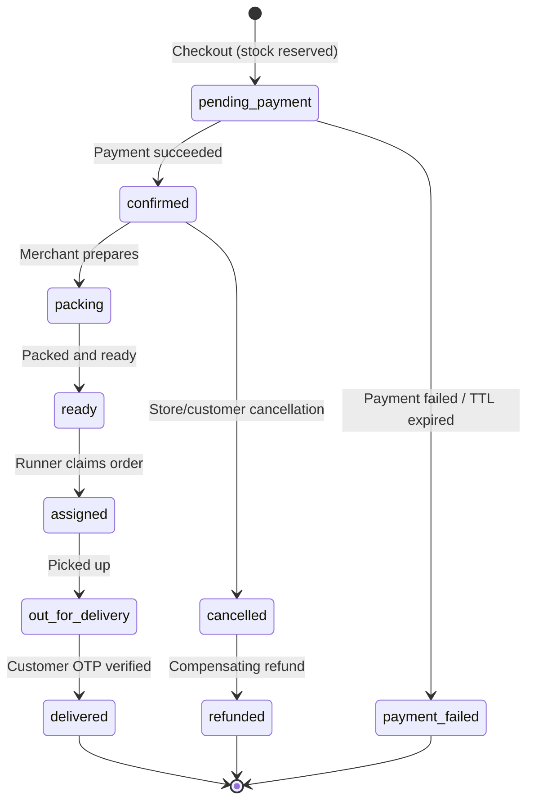
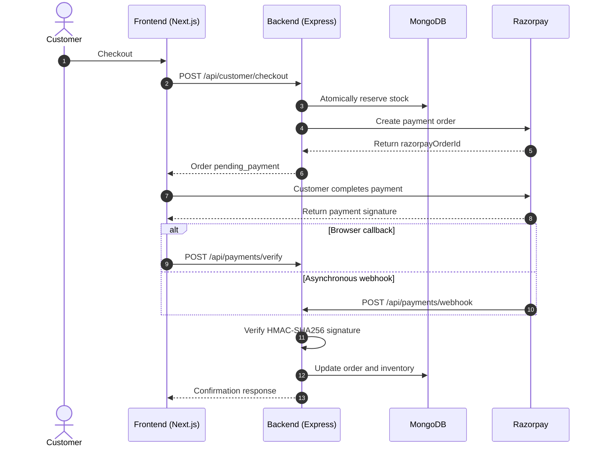

# KiranaWala Workflows

This document preserves the key order-state and payment-flow diagrams so the root README can stay focused on a quick project overview.

## Order state machine

Orders follow an explicit lifecycle enforced by the backend state-transition logic.

## Payment lifecycle and webhook processing

## Reliability and security notes

- Checkout prices and discounts are recalculated by the backend; the client should not be trusted for payable totals.
- Inventory reservation uses conditional MongoDB updates to protect against concurrent checkout attempts.
- The browser verification endpoint provides quick feedback, while Razorpay webhooks provide an asynchronous payment notification path.
- Webhook HMAC verification requires the original request bytes. The backend preserves the raw body and uses timing-safe signature comparison.
- Payment callbacks can arrive late or more than once. State-transition guards and reconciliation help recover eligible pending orders; do not claim exactly-once processing without verifying idempotency behavior.
- Delivery completion requires the customer's OTP and is protected by attempt limits.
